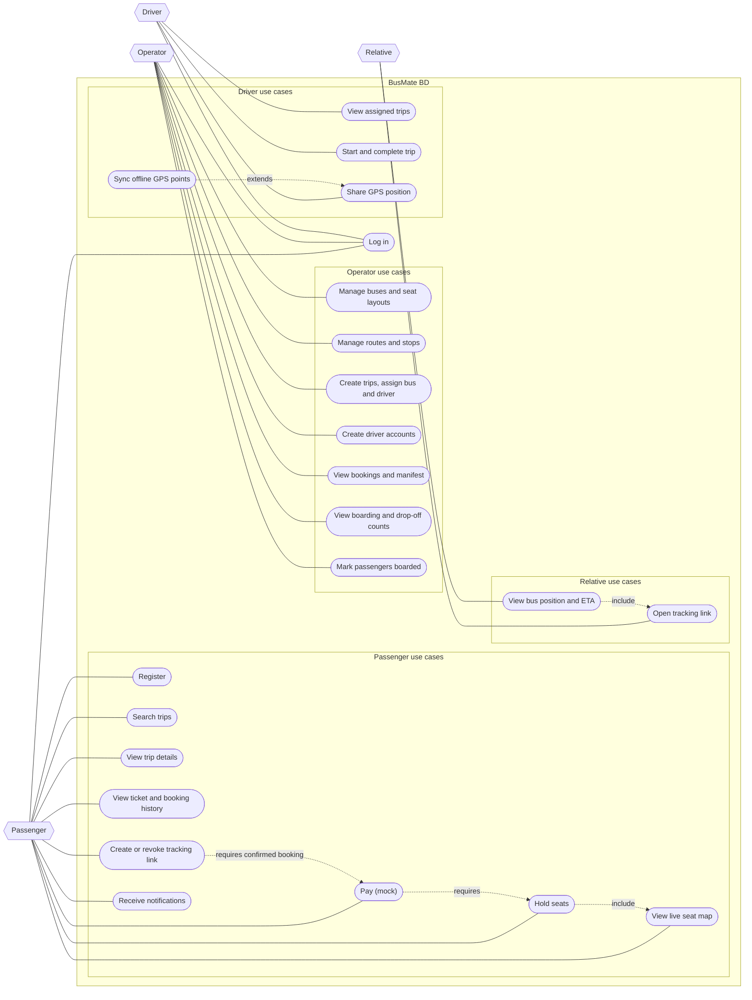

# Diagram 01: Use case diagram

Matches SRS v0.3. Source requirements: FR-P1 to FR-P11, FR-R1 to FR-R3, FR-O1 to FR-O9, FR-D1 to FR-D4.

## What it shows

Everything each of the four actors can do in version 1. Mermaid has no use case diagram type, so this is a flowchart that follows the UML shapes loosely: hexagons are actors, ovals are use cases, the large box is the system boundary. Dotted arrows are dependencies between use cases.

## Components

| Actor | Has an account | Use cases | SRS |
|---|---|---|---|
| Passenger | Yes | Register, search, view trip, seat map, hold seats, pay, ticket and history, tracking link, notifications | FR-P1 to FR-P11 |
| Relative | No | Open a tracking link, view bus position and ETA | FR-R1 to FR-R3 |
| Operator | Yes | Buses and seat layouts, routes and stops, trips, driver accounts, manifest, boarding counts, mark boarded | FR-O1 to FR-O9 |
| Driver | Yes | Assigned trips, start and complete a trip, share GPS, sync offline points | FR-D1 to FR-D4 |

"Sync offline GPS points" extends "Share GPS position": it only happens after a connection drop, so it is an optional branch, not a separate screen.

## How the use cases connect

There is one main chain for a passenger: view the seat map, hold seats, pay, get a ticket, then create a tracking link. Each step depends on the one before it. The relative's chain is shorter, and every request they make is checked against the token, since they never log in.

## Where this diagram can mislead

- "Hold seats" and "Pay (mock)" look like two simple ovals, but they hide the hardest parts of the system: concurrent holds and the payment saga. Those get their own diagrams (07 to 10).
- "Create tracking link" requires a confirmed booking. A passenger whose booking is only held or pending must not be able to create one (BR-27).
- A relative has no session. Every tracking request has to be validated by the token on its own.
- Notifications have no actor who triggers them. They come from events, which diagram 11 will show.
- The SRS mentioned in section 2 that operators create driver accounts, but the requirement list had no entry for it. This diagram includes it, and the SRS needs a new line, FR-O9.

## Decisions

- There is no platform administrator. Operator accounts come from a seed script, and operators create their own drivers.
- A relative is an actor without an account, which keeps the sharing flow simple and puts all the access control in the tracking token.
- "Log in" is one shared use case for passengers, operators and drivers. Role differences are handled by authorization, not by separate login systems.
