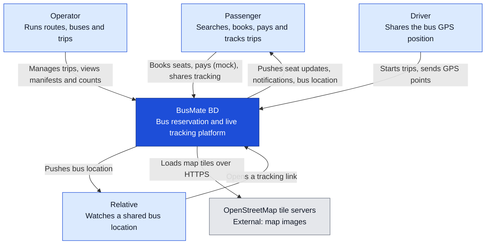

# Diagram 02: C4 system context

The outermost view: BusMate BD as one box, the people who use it, and the systems outside it.

## What it shows

Who uses the platform and what it depends on, with no technology detail. There is only one external system in version 1: the map tile servers.

## Components

- Four kinds of people (passenger, relative, operator, driver), as in the use case diagram.
- BusMate BD, treated as a single system here. Diagram 03 opens it up.
- OpenStreetMap tile servers, which supply the map images for the passenger app, the tracking page and the driver app.

Two things are not drawn as external systems on purpose. The browser Geolocation API is a feature of the driver's phone, not a separate service. The payment provider is mocked inside the platform, so it is part of BusMate BD.

## Communication

People talk to the platform over HTTPS. The platform pushes updates back (seat changes, notifications, bus position) over WebSocket. The map tiles are loaded by the user's browser directly from OpenStreetMap, not through the platform.

## Failure points

- OpenStreetMap's public tile servers are meant for light use. A demo is fine. Real traffic would need a paid or self-hosted tile source. If tiles fail to load, the map goes blank but the bus position and ETA data still arrive.
- The driver's phone is the only source of location data. Poor signal, a dead battery or a closed browser tab stops the tracking, so the tracking page has to show how old the last position is.
- No SMS or email means a passenger who closes the app gets no alert. That is a known limit of version 1.

## Decisions

- Payment is mocked inside the system so no real money or external gateway is involved. The payment service is kept behind its own interface so a real gateway could replace the mock later.
- No SMS or email provider in version 1 (SRS section 1.3). Notifications are in-app only.
- Map tiles come straight from OpenStreetMap, which needs no account or billing setup.
