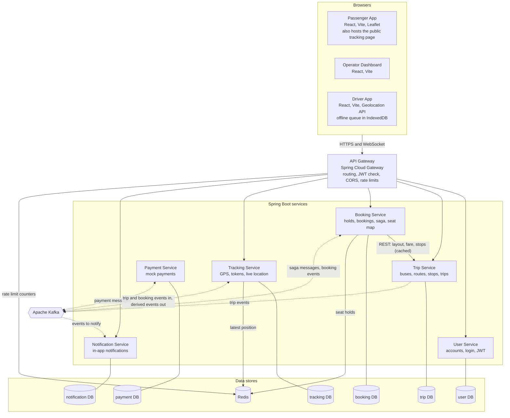

# Diagram 03: C4 container diagram

Opens up BusMate BD: the deployable pieces, what each owns, and how they talk. Solid arrows are synchronous calls. Dotted arrows are Kafka messages.

## Containers

| Container | Technology | Responsibility | Owns |
|---|---|---|---|
| Passenger App | React, Vite, Leaflet | Search, seat map, checkout, tickets, tracking page for relatives | none |
| Operator Dashboard | React, Vite | Buses, routes, trips, manifests, counts | none |
| Driver App | React, Vite, Geolocation API | Start trip, send GPS, queue points when offline | local IndexedDB queue |
| API Gateway | Spring Cloud Gateway | Single entry point, routing, JWT validation, CORS, rate limits, WebSocket proxy | none |
| User Service | Spring Boot | Registration, login, JWT issuing, profiles, operator and driver accounts | user DB |
| Trip Service | Spring Boot | Buses, seat layouts and adjacency, routes, stops, trips, driver assignment, trip lifecycle | trip DB |
| Booking Service | Spring Boot | Seat holds, bookings, payment saga, seat map WebSocket, manifest and boarding queries | booking DB, hold keys in Redis |
| Payment Service | Spring Boot | Mock payments, idempotency | payment DB |
| Tracking Service | Spring Boot | GPS intake and validation, latest position, history, tracking tokens, live WebSocket | tracking DB, position keys in Redis |
| Notification Service | Spring Boot | Reacts to events, stores notifications, pushes them in-app | notification DB |
| PostgreSQL | one server, six databases | Durable state, one database and one user per service | n/a |
| Redis | one instance | Seat holds, latest bus position, rate limit counters | n/a |
| Kafka | one broker (KRaft) | Events and saga messages between services | n/a |

## Communication

1. Browsers talk only to the gateway. It checks the JWT and forwards the request, except on the public tracking routes, which are validated by the tracking token in Tracking Service.
2. Booking Service calls Trip Service over REST for seat layout, fare and stops, with a short cache (decision from the architecture review).
3. Booking and Payment never call each other directly. The saga runs on Kafka: Booking sends a payment request, Payment answers with success or failure.
4. Trip Service publishes trip events (trip started, completed, driver assigned). Tracking Service consumes them to open and close tracking sessions.
5. Notification Service consumes events and turns them into stored in-app notifications.
6. Three services own WebSocket endpoints, all reached through the gateway: Booking (seat map), Tracking (bus position), Notification (alerts).

The gateway has no route to Payment Service. Passengers can only trigger a payment through Booking, which keeps the payment service off the public surface.

## Failure points

| If this fails | What happens | Version 1 behaviour |
|---|---|---|
| API Gateway | Every client loses access | Accepted single point of failure. Later: run two instances |
| Trip Service | Search and trip management stop | Booking can still hold seats for trips whose layout it has cached. New trips are not bookable |
| Booking Service | No holds, bookings or seat map | Payment messages wait in Kafka and are processed when it returns |
| Payment Service | Payment requests wait | Holds expire after 5 minutes. A late success follows BR-10 |
| Redis | Fast seat holds and last position unavailable | Holds fall back to database-only locking (NFR-8). Last position falls back to the newest row in Postgres. Gateway rate limiting fails open |
| Kafka | Saga and events stall | Holds and bookings still work. Events wait in each service's outbox table (NFR-9). Hold expiry still runs, since it is database-based |
| PostgreSQL | The service whose database is down stops | In local development all six databases sit in one container, so one failure stops everything. Production would separate them |
| WebSocket fan-out | Updates reach only clients connected to the same instance | Fine with one instance of each service. Scaling out would need a shared channel such as Redis pub/sub |

## Decisions

- Payment Service is internal only. Booking is the sole entry to payments.
- The saga is orchestrated by Booking and runs over Kafka, not REST. This survives restarts and matches how real payment providers behave, at the cost of more moving parts.
- One PostgreSQL server with a database and a user per service in development. The separate credentials enforce the rule that no service reads another's data, and the single server fits a 7 GB laptop.
- One Redis instance with key prefixes per use (`hold:`, `pos:`, `rl:`) so the uses cannot collide.
- The relative's tracking page lives inside the Passenger App as a public route. No fourth frontend.
- Each WebSocket endpoint is served by the service that owns the data being pushed, so no service needs to relay another's state.
