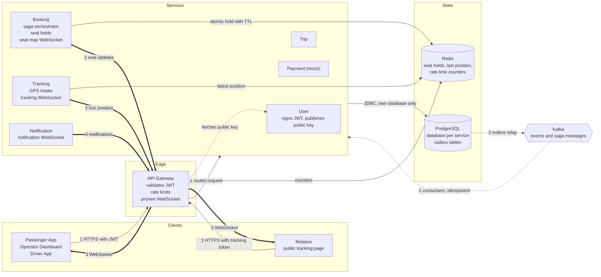

# Diagram 04: High-level system architecture

The container diagram showed what exists. This one shows how requests, events and live updates move through it. Three numbered paths:

1. Request path: a client calls a service through the gateway.
2. Event path: a service writes an event to its own database, and a relay publishes it to Kafka.
3. Push path: a service sends live updates to browsers over WebSocket.

## What it shows

How data moves, with the protocol on each hop. Thin solid arrows are the request path. Dotted arrows are the event path. Thick arrows are the push path.

## Components and who does what

- Gateway: the only public entry. Validates the JWT with a public key fetched from User Service, applies rate limits, and proxies WebSocket connections.
- Services: each checks the JWT again for its own endpoints, so a bug in the gateway does not open the system.
- PostgreSQL holds each service's own data and an outbox table (see below).
- Redis holds short-lived or high-churn data only: seat holds, the last bus position, rate limit counters.
- Kafka carries events and saga messages.

## Communication flow

Path 1, request: browser, gateway (JWT check), service, own database. If a service needs another service's data it makes a REST call (Booking to Trip) or reads an event it received earlier.

Path 2, events: when a service changes state (say, a booking is confirmed), it writes the business row and an outbox row in the same database transaction. A relay inside the service reads new outbox rows and publishes them to Kafka. Consumers handle each message idempotently, because Kafka can deliver a message more than once.

Path 3, push: Booking, Tracking and Notification keep WebSocket connections open to browsers via the gateway. A seat change, a new GPS point or a notification is pushed straight from the owning service, without going through Kafka, so a Kafka problem cannot freeze the live map.

## Failure points

- Business row saved but event never sent. Without the outbox, a crash between the database commit and the Kafka publish loses the event. The outbox fixes this: both writes are one transaction, and the relay retries until Kafka accepts.
- Duplicate events. The relay can publish twice after a retry. Each consumer keeps the ids of events it has processed, or applies changes in a way that repeating them is harmless.
- WebSocket authentication. Browsers cannot send an Authorization header when opening a WebSocket. A logged-in client first asks for a short-lived one-time ticket over REST and opens the socket with it. A relative's socket uses the tracking token instead. Details are in diagram 15.
- Stale seat updates. A delayed message must not overwrite a newer seat state, so each seat update carries a version number and clients ignore older ones.
- Missed updates. A WebSocket can drop. On reconnect the client reloads the full seat map or last position over REST, then resumes the stream.
- Clock differences between the phone and the server. GPS points carry their own timestamp and a sequence number, and the server uses the sequence number for ordering.

## Decisions (to be written as ADRs)

- JWT signed with an asymmetric key pair. Only User Service holds the private key, and everyone else verifies with the public key.
- Transactional outbox in Booking, Payment and Trip, the services that publish business events. Tracking publishes only derived events and can use a simpler approach.
- Live updates bypass Kafka. Kafka is for business events, WebSocket is for what the user sees now.
- Every request gets a correlation id at the gateway, passed to services and written to every log line (NFR-15).
- Single Kafka broker in KRaft mode locally, with no ZooKeeper.

## Mapping to the SRS

| Requirement | Where it is handled |
|---|---|
| NFR-7 one winner per seat | Redis atomic hold plus a unique constraint in the booking database (diagrams 07, 08) |
| NFR-8 Redis down | Booking falls back to database locking |
| NFR-9 Kafka down | Outbox tables hold events until Kafka returns |
| NFR-10 duplicates | Idempotent payment keys and idempotent consumers |
| NFR-15 correlation id | Gateway adds it, every service logs it |
