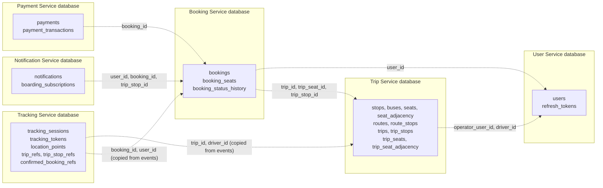
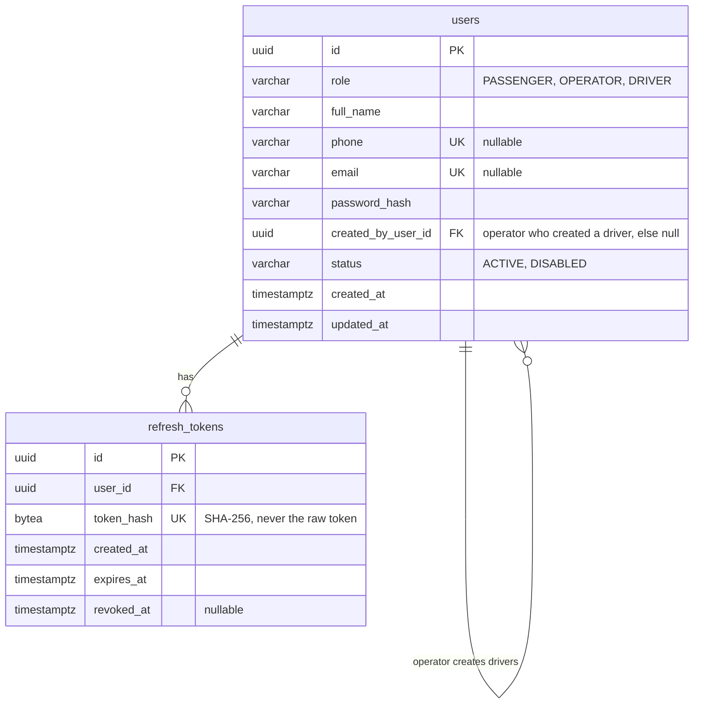
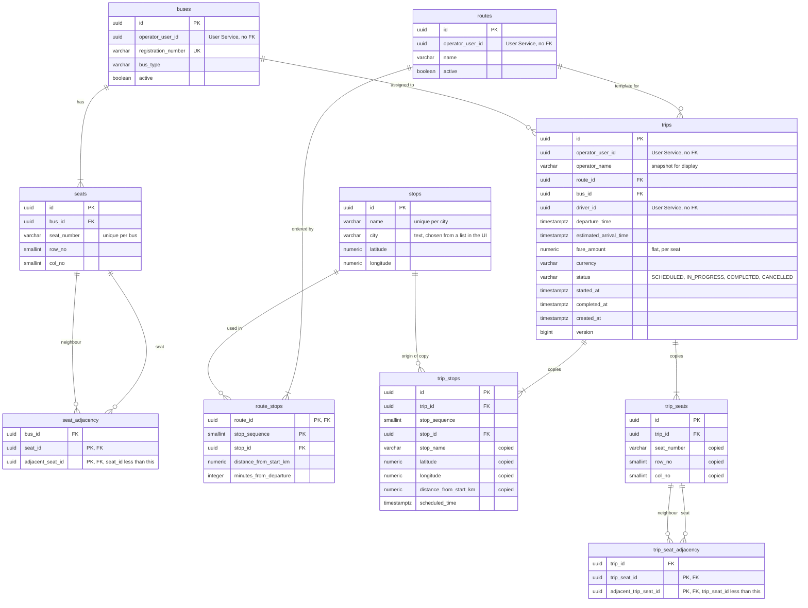
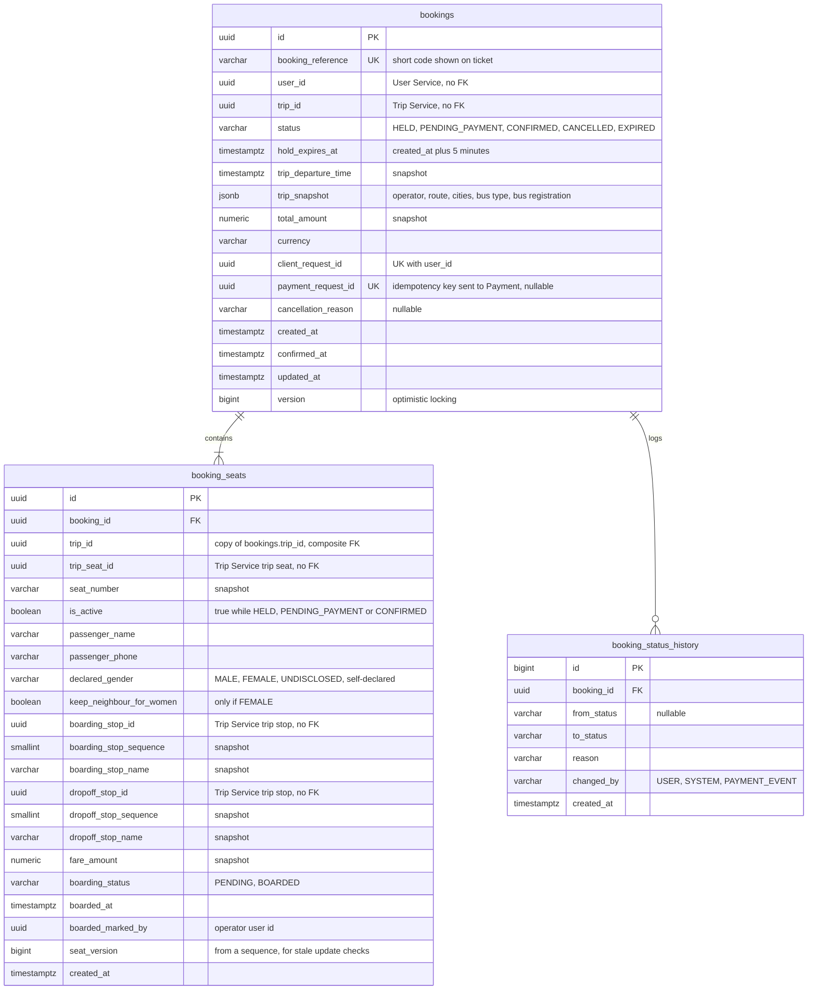
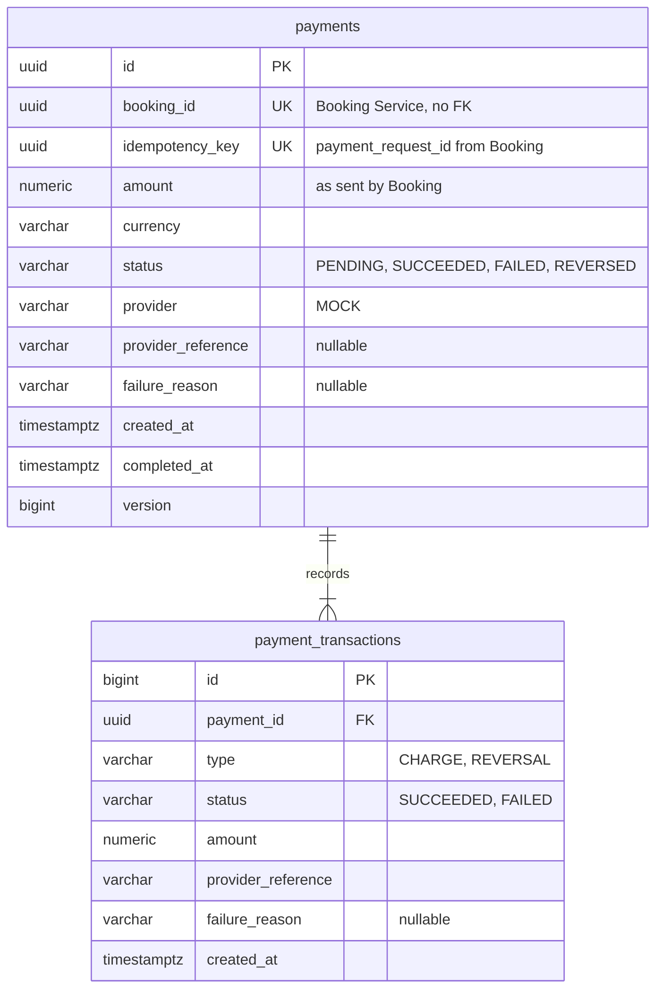
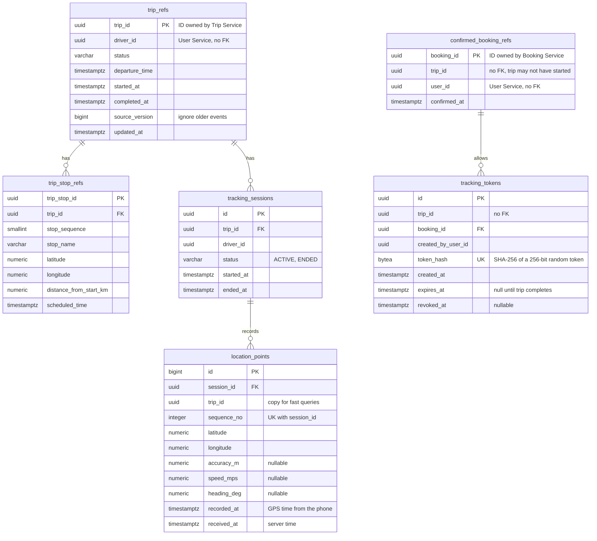
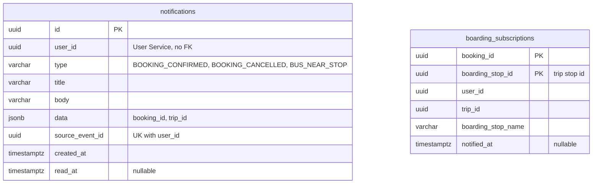
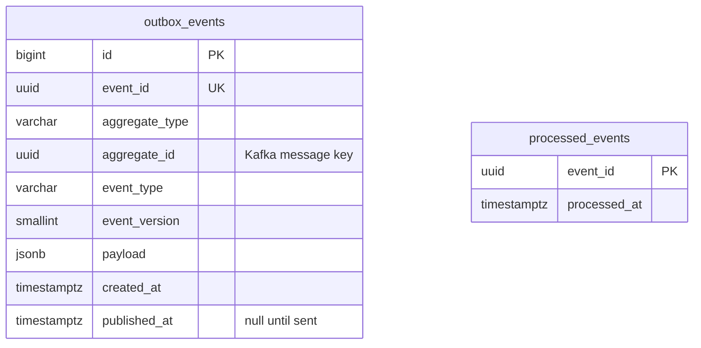

# Diagram 05: Database ER diagram

Status: DRAFT v2 for review. Not final until approved. Based on SRS v0.3 and diagrams 01 to 04. Version 2 reconciles the first proposal with a second independent design; the six decisions that came out of that comparison are in section 2.

Legend: [SRS] is a confirmed requirement. [REC] is a recommendation, not in the SRS. Open questions are in section 13.

## 1. Conventions

- One PostgreSQL database per service. No foreign key crosses a service boundary. Other services' entities are referenced by plain ID columns.
- Primary keys are UUIDs generated by the application (UUIDv7 if available) for entities whose ID is used outside their table. Log-like tables (outbox, status history, GPS points) use a bigint identity.
- Timestamps are `timestamptz`, stored in UTC, shown in Asia/Dhaka.
- Money is `numeric(12,2)` plus a currency code (BDT).
- Statuses are `varchar` with CHECK constraints, not native enums, so Flyway migrations stay simple.
- Rows that other services may reference are not hard-deleted. They get a `status` or `active` flag.

## 2. Decisions taken in review

| ID | Decision | Effect on this diagram |
|---|---|---|
| D1 | Each trip gets its own copy of the bus seats and neighbours (`trip_seats`, `trip_seat_adjacency`), made when the trip is created. | A bus layout can be edited at any time without touching existing trips. Bookings point to `trip_seats`, never to the bus's own seats. |
| D2 | No `operators` or `cities` tables. The operator is identified by the operator's user id. City is a text column on stops. | Fewer tables. Drivers record which operator created them. |
| D3 | No schedule table in v1. | A trip carries its own departure time. |
| D4 | Boarding status is columns on `booking_seats`. | No separate boarding table. |
| D5 | Creating a new hold always requires a successful REST call to Trip Service. | No holds on cached trip data. A short cache may still serve the static seat layout for seat map reads. This changes the Trip Service row of the failure table in diagram 03. That table is not edited here and needs a small follow-up change. |
| D6 | Flat fare per seat, stored on the trip. A failed payment cancels the booking, so there is no payment retry on the same booking in v1. | `trips.fare_amount`, and one payment per booking. |

## 3. Service boundaries

Each box is one database. Dotted arrows are ID references with no foreign key, pointing to the service that owns the entity.



## 4. Ownership

Services that publish business events have an outbox table. Services that consume events have a processed-events table (section 5.7).

| Service | Database | Business tables | Outbox | Processed events |
|---|---|---|---|---|
| User | `user_db` | users, refresh_tokens | no | no |
| Trip | `trip_db` | stops, buses, seats, seat_adjacency, routes, route_stops, trips, trip_stops, trip_seats, trip_seat_adjacency | yes | no |
| Booking | `booking_db` | bookings, booking_seats, booking_status_history | yes | yes |
| Payment | `payment_db` | payments, payment_transactions | yes | yes |
| Tracking | `tracking_db` | trip_refs, trip_stop_refs, confirmed_booking_refs, tracking_sessions, tracking_tokens, location_points | no [REC] | yes |
| Notification | `notification_db` | notifications, boarding_subscriptions | no | yes |

Tracking has no outbox. The only events it publishes are derived ones such as "bus approaching stop", and losing one only skips an in-app alert (diagram 04).

## 5. Entity-relationship diagrams per service

Mermaid ER diagrams cannot draw boundaries, so each service has its own diagram. A comment saying "no FK" marks an ID owned by another service.

### 5.1 User Service



| Entity | Purpose | Key constraints |
|---|---|---|
| users | One account per person, any role. [SRS FR-P1] | CHECK phone or email present. CHECK role in the three values. CHECK `created_by_user_id` is set for DRIVER and null otherwise. FK `created_by_user_id` to users. Gender is not stored here, because it is declared per booking. |
| refresh_tokens | Renews a 15-minute JWT without a new login. [REC, Q7] | FK user_id. UNIQUE token_hash. |

An operator account is created by the seed script. An operator then creates drivers [SRS FR-O9], and the operator's user id is the owner id used in Trip Service.

### 5.2 Trip Service



| Entity | Purpose | Key constraints |
|---|---|---|
| stops | A physical stop with coordinates. [SRS FR-O2] | UNIQUE (city, name). Latitude between -90 and 90, longitude between -180 and 180. |
| buses | A vehicle owned by an operator. [SRS FR-O1] | UNIQUE registration_number. Not hard-deleted. |
| seats, seat_adjacency | The editable seat layout of a bus, and which seats sit side by side. [SRS FR-O1, BR-14] | seats: UNIQUE (bus_id, seat_number), UNIQUE (bus_id, id). seat_adjacency: PK (seat_id, adjacent_seat_id), CHECK seat_id < adjacent_seat_id so each pair is stored once, composite FKs (bus_id, seat_id) and (bus_id, adjacent_seat_id) so both seats are on the same bus. |
| routes, route_stops | A named route and its ordered stops, with distance and time offsets. [SRS FR-O2] | route_stops: PK (route_id, stop_sequence), UNIQUE (route_id, stop_id), CHECK stop_sequence >= 1. A route has at least two stops. |
| trips | One journey: route, bus, driver, departure time, fare. [SRS FR-O3] | FKs route_id, bus_id. CHECK status. CHECK estimated_arrival_time > departure_time. CHECK fare_amount >= 0. Exclusion constraints so one bus, and one driver, cannot have overlapping times [REC]. |
| trip_stops | Copy of the route's stops, made when the trip is created. [REC] | UNIQUE (trip_id, stop_sequence), UNIQUE (trip_id, stop_id). |
| trip_seats, trip_seat_adjacency | Copy of the bus's seats and neighbours, made when the trip is created. [D1] | trip_seats: UNIQUE (trip_id, seat_number), UNIQUE (trip_id, id). trip_seat_adjacency: same pattern as seat_adjacency, with composite FKs on (trip_id, id). |

Cardinalities: one bus has many seats (at least one). One route has an ordered list of stops through route_stops. One trip uses one bus and one route, and owns a copy of the stops and the seats. One trip seat pair appears at most once in trip_seat_adjacency.

Owner checks: `operator_user_id` on buses, routes and trips must equal the logged-in operator. That is checked by Trip Service in the API, since the database cannot see User Service's data.

Trip Service owns the static layout only. Which seats are held or booked is Booking Service's data.

### 5.3 Booking Service



| Entity | Purpose | Key constraints |
|---|---|---|
| bookings | One purchase by one passenger for one trip: status, hold deadline, trip and fare snapshot. [SRS BR-3, BR-7] | UNIQUE booking_reference. UNIQUE (user_id, client_request_id) so a double click does not create two holds. UNIQUE payment_request_id. UNIQUE (id, trip_id) for the composite FK. CHECK status. CHECK CONFIRMED implies confirmed_at is set. CHECK total_amount >= 0. CHECK hold_expires_at > created_at. |
| booking_seats | One row per passenger in one seat: passenger details, stops, fare, boarding status. | FK (booking_id, trip_id) to bookings(id, trip_id). UNIQUE (booking_id, trip_seat_id). CHECK boarding_stop_sequence < dropoff_stop_sequence [SRS BR-18]. CHECK keep_neighbour_for_women implies declared_gender = FEMALE [SRS BR-14]. CHECK boarded_at set when BOARDED. Seat uniqueness is in section 8. |
| booking_status_history | Audit trail of status changes, useful for debugging the saga. [REC] | FK booking_id. Append only. |

Cardinalities: one booking has one to four booking_seats [SRS DEC-1]. That limit cannot be a plain CHECK because it counts child rows, so Booking Service enforces it in the same transaction that creates the rows. One booking has many history rows. A trip seat can appear in many booking_seats rows over time, but only one is active.

Snapshots [SRS BR-7]: `trip_departure_time`, `trip_snapshot`, `total_amount`, each seat's `fare_amount` and `seat_number`, and each stop's id, position and name. None of them is updated after creation.

Gender [SRS BR-11]: the column is `declared_gender` on purpose. It records what the passenger said, and nothing verifies it.

### 5.4 Payment Service



| Entity | Purpose | Key constraints |
|---|---|---|
| payments | One payment per booking and its current state. [SRS FR-P7] | UNIQUE idempotency_key [SRS BR-9]. UNIQUE booking_id (see D6). CHECK amount > 0. |
| payment_transactions | What actually happened: a charge, and possibly a later reversal. | FK payment_id. Partial UNIQUE (payment_id, type) where status = SUCCEEDED, so a payment cannot be charged twice or reversed twice. |

Rules:

- A repeated request with the same idempotency key returns the stored result. If it arrives with a different booking, amount or currency than the stored row, it is rejected, not treated as a new payment.
- Payment stores the amount Booking sent and never recalculates fares.
- Retries do not create rows. A late success followed by a simulated reversal [SRS BR-10] is the reason for the second table: a reversal is a second event on the same payment.
- If a later version allows another attempt after a failure, the booking_id uniqueness becomes a partial unique index (only PENDING or SUCCEEDED). It stays a plain UNIQUE in v1.
- Payment stores no passenger data. Payment outcomes reach passengers through Booking's events, which carry the user id.

### 5.5 Tracking Service



| Entity | Purpose | Key constraints |
|---|---|---|
| trip_refs, trip_stop_refs | Local copy of what Tracking needs about a trip: assigned driver, status, and stops for "next stop" and ETA. Filled from TripStarted and updated by later trip events. [REC] | PK trip_id. UNIQUE (trip_id, stop_sequence). `source_version` lets the consumer ignore out-of-order events. |
| confirmed_booking_refs | Lets Tracking check that a passenger holds a confirmed booking before creating a link [SRS BR-27], without calling Booking. Filled from BookingConfirmed. [REC] | PK booking_id. Ids only: no name, phone or gender. |
| tracking_sessions | One continuous period of GPS sharing. A trip can have several if the driver stops and restarts [SRS FR-D2]. | Partial UNIQUE (trip_id) where status = ACTIVE. |
| location_points | GPS history. [SRS BR-22] | UNIQUE (session_id, sequence_no), so a duplicate point is a no-op (`ON CONFLICT DO NOTHING`) [SRS BR-24]. Index (trip_id, recorded_at). Latitude and longitude range checks. |
| tracking_tokens | Shareable links. [SRS BR-26 to BR-29] | UNIQUE token_hash. Index (trip_id). FK booking_id to confirmed_booking_refs. |

Token rules:

- Only a SHA-256 hash is stored. The token is 256 random bits, so a fast hash is enough. The raw token is shown once at creation and never logged.
- `expires_at` stays null until the trip ends. When TripCompleted arrives, Tracking sets it to `completed_at` plus 2 hours for all tokens on that trip [SRS BR-28, DEC-6]. A link works while `revoked_at` is null and `expires_at` is null or in the future. See Q2 for trips that never complete.
- The token row has user and booking ids but no passenger name, phone, gender or seat. The tracking API reads only trip, stop and position data [SRS BR-29]. A token and a tracking session are not linked by a foreign key, so a link can be created before GPS sharing starts.

### 5.6 Notification Service



| Entity | Purpose | Key constraints |
|---|---|---|
| notifications | Stored in-app notifications. [SRS FR-P11] | UNIQUE (source_event_id, user_id), so a replayed event does not notify twice and one event can still notify several users. Index (user_id, created_at desc). Partial index on unread rows. |
| boarding_subscriptions | Who should be told when the bus nears which stop. Filled from BookingConfirmed. [REC] | PK (booking_id, boarding_stop_id). `notified_at` stops repeat alerts if the bus moves in and out of range. |

Notification text must carry only what the notification needs. No phone numbers or other personal details go into events or notification bodies. Notification reads Booking's events (which carry the user id) for payment outcomes, and Tracking's "approaching stop" event for bus alerts.

### 5.7 Shared technical tables

These exist in the services listed in section 4. They are not business entities.



- `outbox_events` is written in the same transaction as the business change. A relay publishes rows where `published_at` is null, oldest first, then sets the column. The aggregate id as Kafka key keeps all events of one booking in order [SRS NFR-9].
- `processed_events` stores the id of every event a consumer has handled. The consumer inserts the id in the same transaction as its business change. If the insert conflicts, the event is a duplicate and is skipped [SRS NFR-10].
- Events carry ids only. Passenger names, phones and genders stay in Booking.

## 6. Cross-service references

| Column | Holds the id of | Owner | How it stays consistent |
|---|---|---|---|
| buses, routes, trips `operator_user_id` | operator account | User | Taken from the JWT when the row is created. Accounts are disabled, not deleted. |
| trips.driver_id | driver account | User | Checked at assignment time (Q6). |
| bookings.user_id | passenger | User | Taken from the JWT subject. |
| bookings.trip_id, booking_seats.trip_seat_id, stop ids | trip, trip seat, trip stop | Trip | Validated by a REST call to Trip Service every time a new hold is created (D5). Trips and their copies are not hard-deleted. |
| payments.booking_id | booking | Booking | Comes from the PaymentRequested message. |
| trip_refs, trip_stop_refs | trip, trip stops | Trip | Copied from trip events, versioned. |
| confirmed_booking_refs, tracking_tokens.booking_id | booking | Booking | Copied from BookingConfirmed. |
| notifications.user_id, boarding_subscriptions | user, booking, trip stop | User, Booking, Trip | Copied from events, never queried live. |

These data needs shape the event contracts in diagram 11. TripStarted must carry the driver and the stop list. TripCompleted is needed. A driver-changed event is needed. BookingConfirmed must carry user id, trip id and the boarding stops but no personal details.

## 7. Relationships explained

| Relationship | Result |
|---|---|
| One bus has many seats | Kept. The bus layout is editable. |
| One route has many ordered stops through route_stops | Kept. |
| One trip uses one bus and one route | Kept, and the trip also copies the stops and seats (D1). Editing a route or a bus later does not change existing trips. |
| One trip has multiple bookings | Kept logically, with no foreign key. Booking stores `trip_id` and a snapshot. |
| One booking can contain multiple booked seats | Kept as booking_seats, which also carries the passenger details. |
| One booking can have multiple payment attempts | Not in v1 (D6). A failed payment cancels the booking, so a retry means a new booking. Retried requests reuse the idempotency key. A payment has several rows in payment_transactions only for a charge and a possible reversal. |
| One tracking session contains multiple GPS points | Kept. A trip can also have several sessions. |

## 8. Constraints and indexes that carry the business rules

The most important, as SQL because the exact condition matters:

```sql
-- No seat sold twice on one trip, enforced by the database [SRS BR-5]
CREATE UNIQUE INDEX uq_active_seat_per_trip
    ON booking_seats (trip_id, trip_seat_id) WHERE is_active;

-- Duplicate GPS points are ignored [SRS BR-24]
ALTER TABLE location_points
    ADD CONSTRAINT uq_point UNIQUE (session_id, sequence_no);
```

`is_active` is set to false in the same transaction that moves a booking to CANCELLED or EXPIRED. If a bug leaves it true, the seat stays blocked. It is never sold twice, so the failure is safe. The payment rule is a plain `UNIQUE (booking_id)` and `UNIQUE (idempotency_key)` on payments [SRS BR-9].

Other indexes (recommended):

| Table | Index | Used for |
|---|---|---|
| trips | (departure_time), (route_id, departure_time) | Trip search |
| stops | (city) | Search by city |
| route_stops | (stop_id) | Finding routes that pass a city |
| bookings | (user_id, created_at desc) | Booking history |
| bookings | (status, hold_expires_at) where status is HELD or PENDING_PAYMENT | The expiry sweeper |
| booking_seats | (trip_id, boarding_stop_id), (trip_id, dropoff_stop_id) | Boarding and drop-off counts |
| location_points | (trip_id, recorded_at) | Replaying a trip |
| outbox_events | (id) where published_at is null | The relay |
| notifications | (user_id, created_at desc) | Notification list |

Extension needed: `btree_gist`, for the bus and driver time-overlap exclusion constraints on trips. It ships with PostgreSQL.

## 9. Business rules and where they are enforced

| Rule | Mechanism |
|---|---|
| Hold lasts five minutes [BR-2] | `hold_expires_at` on bookings, a Redis key with a 300 second TTL, and a sweeper that moves overdue rows to EXPIRED. |
| No seat booked twice on a trip [BR-5] | Partial unique index on booking_seats. Redis is only the fast first gate. |
| No seat reuse across segments in v1 [BR-5] | The same index ignores stops. Stop positions are stored per seat so the rule can later become an overlap constraint without changing the data. |
| Snapshots of trip, fare and stops [BR-7] | Snapshot columns on bookings and booking_seats, written once. |
| Expired holds cannot be confirmed [BR-2] | A booking in EXPIRED cannot move to CONFIRMED by the normal path. The only way back is the late-payment case below. |
| Payments are idempotent [BR-9] | UNIQUE idempotency_key, UNIQUE booking_id, mismatch rejection, one successful transaction per type. |
| Late payment success [BR-10] | The booking is EXPIRED, so Booking tries to set `is_active` back to true. If the unique index accepts it, the seat is still free and the booking is confirmed. If it conflicts, someone else has the seat, so Booking asks Payment for a reversal (a REVERSAL row) and the passenger is notified. Payment never decides seat availability. |
| Tokens are secure, revocable, expire 2 hours after completion [BR-26 to BR-28] | Hash only, `revoked_at`, `expires_at` set on TripCompleted. |
| Tracking shows no personal data [BR-29] | Tracking's tables hold ids only. Passenger details exist only in booking_seats. |
| Gender is self-declared, not verified [BR-11] | Column named `declared_gender`, no verification fields, UNDISCLOSED allowed. |
| Women-only neighbour restriction lifts 2 hours before departure [BR-15] | Computed from `bookings.trip_departure_time`. No scheduled job. See Q5 for the concurrency issue. |
| Gender icon only on CONFIRMED seats [BR-13] | A read-time rule on the seat map query. |

## 10. Why Redis data is not stored as permanent PostgreSQL data

| Redis data | Why it stays out of PostgreSQL |
|---|---|
| Seat hold keys (`hold:{trip}:{trip_seat}`) with a 5 minute TTL | A hold is a short lock. Redis expires it by itself, while PostgreSQL would need a delete job and write traffic for data that lives five minutes. The durable record is the HELD booking row. Redis only answers "is anyone holding this right now" cheaply. If Redis is lost, no booking is lost: the database still enforces uniqueness and the sweeper handles expiry. |
| Latest bus position (`pos:{trip}`) | Overwritten every 5 seconds. Writing every overwrite to a table adds disk work for a value that is stale after the next point. History is in `location_points`, and the latest position can be rebuilt from the newest row. |
| WebSocket tickets, rate limit counters, cached layouts | Short-lived and safe to lose. |

A Redis key expiring does not update a PostgreSQL row. Booking Service processes expiry itself and changes the status in a transaction.

## 11. Self-review

| Question | Answer |
|---|---|
| Can two passengers book the same seat on one trip? | No. The partial unique index rejects the second active row, even if Redis fails or is bypassed. |
| Can a booking keep its original fare after a fare change? | Yes. Fare is copied into `total_amount` and each seat's `fare_amount` and never updated. |
| Can an operator change a route without changing historical bookings? | Yes. Trips copy the stops, and bookings copy stop names and positions, so editing route_stops only affects trips created afterwards. |
| Can an operator change a bus layout without affecting trips? | Yes. Trips copy the seats (D1). |
| Can payment retries be tracked safely? | Yes, through the idempotency key. A retry returns the stored result, and a mismatching retry is rejected. |
| Can a booking refer to a trip without a cross-service foreign key? | Yes, by `trip_id` plus snapshots. The database cannot check that the trip exists, so Booking verifies it through REST on every new hold (D5). |
| Can GPS history be stored independently from the latest position? | Yes. History is in PostgreSQL, latest is in Redis, and Redis can be rebuilt from history. |
| Unnecessary entities or duplicated data? | See below. |

Duplication that is deliberate: trip_stops and trip_seats (protect trips from route and bus edits), the booking snapshots, `booking_seats.trip_id` and `is_active` (both needed for the unique index), and the local copies in Tracking and Notification (so they never call other services per request).

Entities I would cut first for a smaller model: booking_status_history, refresh_tokens, and seat_adjacency plus trip_seat_adjacency (replaced by a `pair_group` column on seats and trip_seats).

## 12. Changes from the original brief's table list

| Original | Now |
|---|---|
| user_profiles, user_preferences | Merged into users. No preferences exist in the SRS, and gender is declared per booking. |
| trip_seat_assignments | Replaced by trip_seats, a static copy of the layout. Seat state belongs to Booking. |
| booking_seat_holds | Removed. A hold is a booking in HELD plus a Redis key. |
| booking_passenger_details | Merged into booking_seats. |
| tracking_sessions, tracking_tokens, location_points | Kept. |
| notification_records | Renamed notifications. |
| Added | seat_adjacency, trip_seat_adjacency, trip_stops, trip_seats, refresh_tokens, trip_refs, trip_stop_refs, confirmed_booking_refs, boarding_subscriptions, outbox_events, processed_events. |

## 13. Open decisions

| ID | Question | Recommendation |
|---|---|---|
| Q1 | What happens when an operator cancels a trip that has bookings? The SRS is silent and refunds are out of scope. | Keep CANCELLED in the status list but do not build trip cancellation in v1. |
| Q2 | A trip never marked COMPLETED would leave tracking tokens valid forever. | Add a hard expiry (for example 7 days after departure) as a safety cap. This is a new rule and needs your approval. |
| Q3 | How long is GPS history kept? | 90 days, then delete or archive. About 7,000 points per 10 hour trip at one point every 5 seconds. |
| Q4 | Late payment on an expired booking: move EXPIRED to CONFIRMED, or add a new status? | Allow EXPIRED to CONFIRMED only in that case. Decide in diagram 06. |
| Q5 | The women-only rule checks two seats, so two concurrent bookings of neighbouring seats could slip past each other. | Take a database advisory lock per trip and seat pair while booking. Decide in diagrams 07 and 08. |
| Q6 | How does Trip Service know a driver id is valid and belongs to the operator? Diagram 03 has no arrow from Trip to User. | A REST call at assignment time. Diagram 03 would need a new arrow, which I have not edited. |
| Q7 | Are refresh tokens in v1? Not in the SRS. | Yes, otherwise users log in every 15 minutes. |
| Q8 | How long are passenger name, phone and gender kept after a trip? (NFR-6) | Decide a retention period before any real use. Not needed for the learning version. |
| Q9 | Where does `trips.operator_name` come from, since there is no operators table? | Copy it from the operator's name in the JWT when the trip is created. |
| Q10 | City is free text on stops, so spellings can differ. | Use a fixed pick list in the operator UI. Add a cities table later only if needed. |
