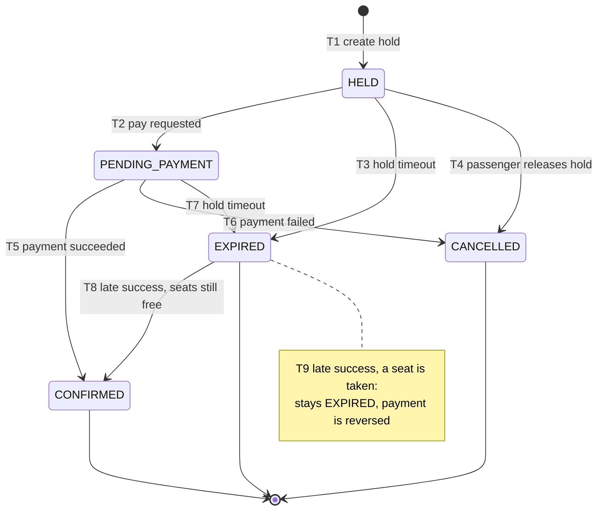
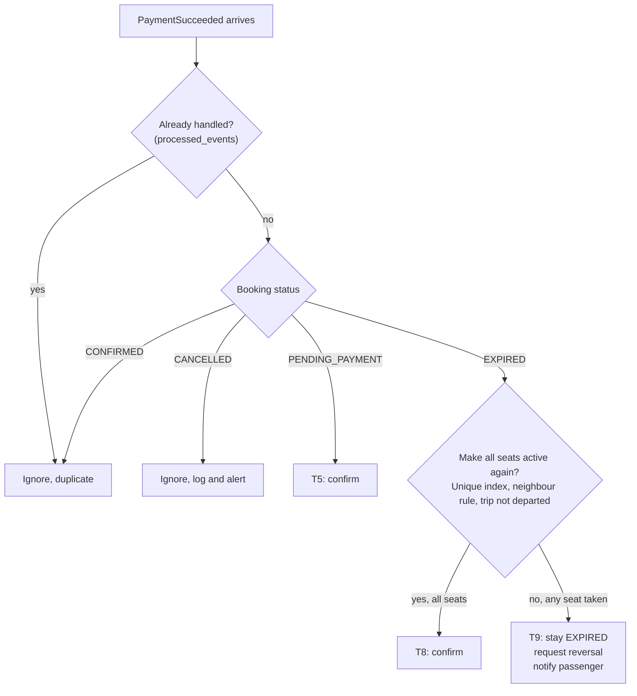

# Diagram 06: Booking state diagram

Status: APPROVED on 2026-11-17. Based on SRS v0.4, diagram 04 and diagram 05 v2.

Legend: [SRS] is a confirmed requirement. [REC] is a recommendation, not in the SRS. Decisions are in section 9.

## 1. What it shows

Every status a booking can have, every allowed move between statuses, and what must happen in the database and on Kafka when it moves. The statuses are the five from SRS BR-3. This diagram also settles Q4 from diagram 05: how a payment that succeeds after the hold expired is handled.

## 2. State diagram

T4 is FR-P12 in SRS v0.4. Everything else follows the SRS. In version 1 a confirmed booking is final, because cancellation and refunds are out of scope [SRS section 1.3].

## 3. States

| State | Meaning | Seat rows `is_active` | Seat map shows | Final? |
|---|---|---|---|---|
| HELD | Seats are held for this passenger, payment not started. | true | held (taken) | no |
| PENDING_PAYMENT | A payment was requested and no result has arrived. | true | held (taken) | no |
| CONFIRMED | Payment succeeded. The ticket exists. | true | booked, with gender icon [SRS DEC-3] | yes |
| CANCELLED | The booking was cancelled (payment failed, or the passenger released the hold). | false | available | yes |
| EXPIRED | The 5 minute hold ran out. | false | available | yes, except for T8 |

All seat rows of a booking always have the same `is_active` value, and it changes in the same transaction as the booking status. A seat on the map is available when no active row exists for it. A seat next to a woman who asked for a women-only neighbour is shown as available for women only, until 2 hours before departure [SRS BR-14, BR-15].

## 4. Transitions

Every transition runs in one database transaction that also writes the outbox row and a `booking_status_history` row. Every transition is guarded: it only applies if the booking is in the expected status, so a repeated message or request changes nothing.

| ID | Move | Trigger | Guard | What changes | Event published |
|---|---|---|---|---|---|
| T1 | (new) to HELD | Passenger creates a hold | Trip Service confirms the trip and seats (D5). 1 to 4 seats. Every seat is free. The `client_request_id` is new. | Insert booking and booking_seats with `is_active` true. `hold_expires_at` is now plus 5 minutes. Redis keys with a 300 second TTL. | SeatHeld |
| T2 | HELD to PENDING_PAYMENT | Passenger pays | Status is HELD and `hold_expires_at` is still in the future, by the database clock. | Set `payment_request_id`. The deadline does not move [SRS BR-2]. | PaymentRequested |
| T3 | HELD to EXPIRED | Expiry sweeper, or lazy expiry (SD-3) | `hold_expires_at` has passed. | `is_active` false on all seats. Redis keys deleted. | BookingExpired, SeatReleased |
| T4 | HELD to CANCELLED [SRS FR-P12] | Passenger releases the hold | Status is HELD and the booking belongs to the caller. A repeated request returns the current status. | `is_active` false. Reason PASSENGER_RELEASED. | BookingCancelled, SeatReleased |
| T5 | PENDING_PAYMENT to CONFIRMED | PaymentSucceeded | Status is PENDING_PAYMENT (see section 6 for the moment around the deadline). | `confirmed_at` set. Seats stay active. | BookingConfirmed |
| T6 | PENDING_PAYMENT to CANCELLED | PaymentFailed | Status is PENDING_PAYMENT. | `is_active` false. Reason PAYMENT_FAILED. [SRS acceptance criterion 5] | BookingCancelled, SeatReleased |
| T7 | PENDING_PAYMENT to EXPIRED | Expiry sweeper | `hold_expires_at` has passed and no result arrived. | Same as T3. | BookingExpired, SeatReleased |
| T8 | EXPIRED to CONFIRMED | PaymentSucceeded arriving late | Every seat can be made active again (the unique index accepts each one), no neighbour rule is broken (SD-2), and the trip has not departed (PS-2). All or none. | `is_active` true on all seats. `confirmed_at` set. [SRS BR-10] | BookingConfirmed |
| T9 | EXPIRED, no change | PaymentSucceeded arriving late | At least one seat is taken, the neighbour rule is broken, or the trip has departed. | No seat change. History row LATE_PAYMENT_SEAT_TAKEN. [SRS BR-10] | PaymentReversalRequested, BookingLatePaymentRejected |

## 5. Moves that are not allowed

| Move | Why |
|---|---|
| Anything out of CONFIRMED | Cancellation and refunds are out of scope in v1. |
| Anything out of CANCELLED | A new attempt is a new booking. |
| EXPIRED to HELD or PENDING_PAYMENT | The hold is not extended [SRS BR-2]. A new attempt is a new booking. |
| HELD to CONFIRMED | Confirmation only follows a successful payment [SRS BR-8]. |
| PENDING_PAYMENT to HELD | There is no way back from a payment request. |

A message that would cause one of these (for example PaymentFailed arriving for an EXPIRED booking, or PaymentSucceeded arriving for a CANCELLED one) is ignored and logged. The contradictory ones, such as success after cancellation, should also raise an alert, because Payment Service should never produce them.

## 6. Late payment decision

This is the logic behind T5, T8 and T9, run when PaymentSucceeded arrives.

Expiry is a status change, not a clock reading. A success that arrives just after `hold_expires_at` but before the sweeper has run finds the booking still in PENDING_PAYMENT, with its seats still exclusively held, so it is confirmed through T5. This follows BR-10 (confirm when the seat is still free) and is listed as SD-5 for your review. Once the status has become EXPIRED, only T8 or T9 are possible.

## 7. Races and how they are resolved

| Race | Resolution |
|---|---|
| PaymentSucceeded and the sweeper act on the same booking at once | Both update with `WHERE version = ?` (optimistic locking). One wins. If the sweeper wins, the late-success path (T8 or T9) takes over. If the payment wins, the sweeper skips a CONFIRMED booking. |
| The passenger double-clicks Pay | The second request finds the booking already PENDING_PAYMENT, or the same `payment_request_id`, and returns the current status. Payment's idempotency key also prevents a second charge [SRS BR-9]. |
| A new passenger tries a seat whose hold has timed out but the sweeper has not run | With lazy expiry (SD-3), the hold request first expires overdue rows for those seats, in the same transaction. Without it, the unique index rejects the request until the sweeper runs. |
| Late success and a new hold compete for the same seat | Both go through the unique index on `(trip_id, trip_seat_id)` where `is_active`. The first commit wins. If the new hold wins, the late success becomes T9. If the late success wins, the new hold fails with "seat unavailable". |
| The same event is delivered twice | `processed_events` skips it, and every transition is guarded by the current status, so a replay changes nothing. |
| The Redis key expires, or Redis is down | Redis is not a booking status. Only the database status decides. If Redis is gone, holds fall back to database locking [SRS NFR-8]. |
| Servers and the passenger's phone disagree on the time | Only the database clock (`now()` in PostgreSQL) is used for `hold_expires_at` comparisons. The countdown in the browser is a display only. |

## 8. Failure points

| If this fails | Effect | Behaviour |
|---|---|---|
| Booking Service crashes in the middle of a transition | None, the transaction rolls back. | The outbox row and the status change are one transaction, so either both exist or neither. After a restart the sweeper catches up and Kafka redelivers any event not yet acknowledged. |
| Kafka is down | PaymentSucceeded cannot arrive, so the booking expires. | When Kafka returns the success arrives late and goes through T8 or T9. The passenger either gets the seat or a reversal. |
| Payment Service is down or slow | No result before the deadline. | Same as above. |
| The sweeper stops | Seats stay blocked after their time. | Lazy expiry (SD-3) frees a seat as soon as someone wants it. The sweeper health is also a metric to watch. |
| Booking cannot reach Trip Service | New holds are refused (D5). | Existing bookings, payments and tracking are not affected. |

## 9. Decisions

Settled by this diagram:

- Q4 from diagram 05: EXPIRED may move to CONFIRMED only through T8, and only when all seats can be re-acquired.
- Hold timeouts apply to HELD and PENDING_PAYMENT alike. There is no grace period, so the hold is never extended [SRS BR-2]. A payment that finishes late is handled by T8 and T9.
- A booking does not change status when a seat is boarded, or when the trip ends. Boarding is a per-seat column in booking_seats.

Decided on 2026-11-17, all accepted as recommended:

| ID | Question | Decision |
|---|---|---|
| SD-1 | May a passenger release a hold before it expires (T4)? Not in the SRS. | Yes. It frees seats sooner for others and is a normal "back" action. This is FR-P12 in the SRS. It needs one endpoint and one reason value. |
| SD-2 | On a late success, a neighbouring seat may have been booked in the meantime, so a woman's "keep my neighbour for women" request can no longer be honoured. | Treat it as "seat not available" and reverse the payment (T9), because the preference is a safety feature. The alternative is to confirm and drop the preference silently, which I would not do. SRS BR-10 now says this. |
| SD-3 | Lazy expiry on contention, in addition to the sweeper? | Yes. Without it a seat can stay blocked for up to a full sweep interval after its hold ended. |
| SD-4 | Sweeper interval. | Every 10 seconds, so a seat is free again at most about 10 seconds after the 5 minutes, even without lazy expiry. |
| SD-5 | A success arriving after the deadline but before the sweeper marks the booking EXPIRED is confirmed (T5), not treated as late. | Yes. The seat is still exclusively held and nobody lost out, which matches BR-10. SRS BR-2 now says this. |
| SD-6 | After T9 the booking stays EXPIRED, with a history reason, instead of becoming CANCELLED. | Yes. BookingExpired was already published, and a second terminal event would confuse consumers. The ticket screen can show "expired, payment reversed". |

New events this diagram needs, now defined in diagram 11: PaymentReversalRequested (Booking to Payment), PaymentReversed (Payment to Booking), and BookingLatePaymentRejected (Booking to Notification, so the passenger is told). Neither is in the original event list.

## 10. Release behaviour (FR-P12, transition T4)

| Booking status when "release" is called | Result |
|---|---|
| HELD, owned by the caller | Becomes CANCELLED with reason PASSENGER_RELEASED. All seats are freed. BookingCancelled and SeatReleased are published. |
| CANCELLED because of an earlier release | Success. The current status is returned (the call is idempotent). |
| EXPIRED | Success. The response says the hold already expired. |
| PENDING_PAYMENT or CONFIRMED | Rejected with a conflict error. A payment is already on its way, or the booking is final. |
| Belongs to another passenger, or does not exist | Rejected as not found, so nothing about other bookings leaks. |
