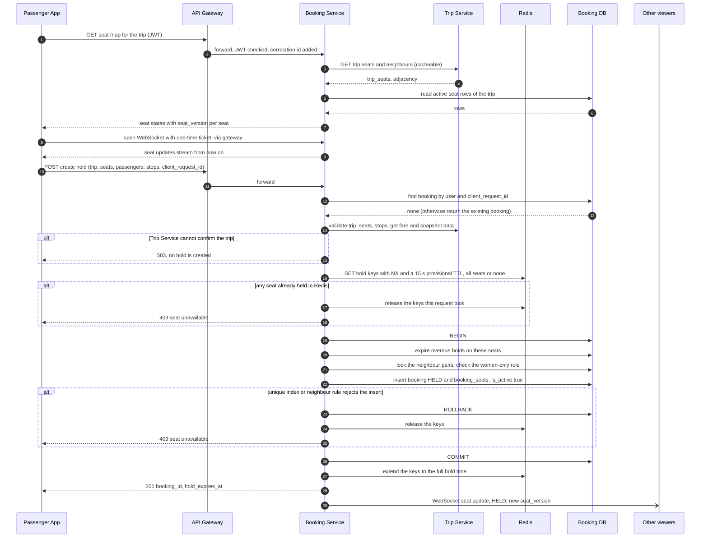
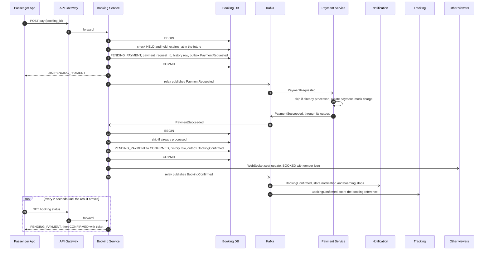

# Diagram 07: Seat booking sequence

Status: DRAFT for review. Not final until approved. Based on SRS v0.4 and diagrams 03, 05 v2, 06 and 11.

Legend: [SRS] is a confirmed requirement. [REC] is a recommendation, not in the SRS. Open questions are in section 7.

## 1. What it shows

The normal path of a booking, step by step: the passenger opens the seat map, holds seats, pays, and gets a confirmed ticket. It follows transitions T1, T2 and T5 of diagram 06.

Two other diagrams go deeper where this one stays on the happy path. Diagram 08 shows two passengers competing for the same seat. Diagram 09 shows payment failure, duplicates and the late-payment cases.

URL paths in this diagram are provisional. The final names come with the API contracts.

## 2. Part A: seat map and hold (T1)

### Steps in words

1. The seat map comes from Booking Service. It combines the trip's static seat layout (from Trip Service, safe to cache because trip seats never change after the trip is created) with the active seat rows in its own database. Seat states are available, held, booked (with a gender icon on confirmed seats only [SRS DEC-3]), and women-only for seats next to a woman who asked for a women-only neighbour.
2. The browser opens a WebSocket with a one-time ticket, because browsers cannot send an Authorization header on a WebSocket (diagram 04). Updates carry a `seat_version`, and the client ignores any update older than what it has.
3. The hold request carries a `client_request_id`. A double click, or a retry after a timeout, finds the existing booking and returns it instead of creating a second one.
4. Booking Service must reach Trip Service for every new hold [D5]. It validates the trip is bookable, the seats belong to it, and the stops are in order, and it receives the fare and the data for the booking snapshot [SRS BR-7].
5. Redis is the fast first gate. All seat keys are taken together or none are, using one atomic script, so a request for three seats never leaves two of them locked. The key value is the booking id. The keys start with a 15 second provisional TTL and are extended to the full hold time after the database commit, so a crash cannot leave a ghost key behind.
6. The database transaction is the real guard. It expires overdue holds on these seats first (lazy expiry, SD-3), takes a lock on the neighbour pairs, checks the women-only rule, and inserts the booking and its seats. The unique index on active seats is the last line of defence [SRS BR-5].
7. `hold_expires_at` is the database clock plus 5 minutes. The response sends it to the browser so the countdown starts from the server's time.
8. The WebSocket update is sent after the commit, never before. SeatHeld is not published to Kafka in v1 (EV-1), so no outbox row is written.

## 3. Part B: pay and confirm (T2, T5)

### Steps in words

1. Paying is a request, not a charge. Booking Service checks the booking is still HELD and not past its deadline by the database clock, moves it to PENDING_PAYMENT, and writes the PaymentRequested event in the same transaction. The deadline does not move [SRS BR-2].
2. The answer to the passenger is 202: the request was accepted, the result will come later. The payment itself runs through Kafka, so Booking and Payment never call each other directly (diagram 03).
3. Payment Service checks it has not seen this request before, creates its payment record, and runs the mock charge. Its outcome goes back through its own outbox.
4. When PaymentSucceeded arrives, Booking Service confirms the booking in one transaction with the status change, the history row and the BookingConfirmed event. The version check on the booking stops this from racing with the expiry sweeper (diagram 06 section 7).
5. After the commit, other viewers see the seat turn booked, with the gender icon. Notification and Tracking each get BookingConfirmed from Kafka and keep only ids.
6. The passenger app finds out by polling the booking status every 2 seconds, up to the hold deadline. This needs no extra WebSocket (SQ-1).

## 4. Failure points

| Where | What goes wrong | What happens |
|---|---|---|
| Trip Service is down or slow | Booking cannot validate the trip | 503 and no hold. Nothing was changed [D5]. |
| Redis is down | The fast gate is unavailable | Booking skips Redis and relies on the database lock and unique index. Slower, still correct [SRS NFR-8]. |
| Booking crashes after taking Redis keys but before the database insert | Orphan keys: a seat looks held in Redis though no booking exists | The keys only have a 15 second provisional TTL until the commit, so the ghost key disappears on its own (SQ-3). |
| The database insert fails | Unique index or neighbour rule | Rollback, Redis keys released, 409. |
| The WebSocket push is lost | Another viewer's map is out of date | The database is the truth. A reconnecting client reloads the map, and a hold attempt on a taken seat fails cleanly. |
| The same hold request arrives twice | Possible double booking | `client_request_id` returns the existing booking. |
| Pay is clicked twice | Possible double charge | The second request finds PENDING_PAYMENT and returns its status. Payment's idempotency key backs this up [SRS BR-9]. |
| Kafka is down when paying | PaymentRequested waits in the outbox | The hold may expire. A success after that goes through T8 or T9 (diagram 06). |
| The browser's clock is wrong | The countdown is off | The countdown starts from the server's `hold_expires_at`. Only the database clock decides expiry. |

## 5. What this diagram assumes from earlier

- The seat-uniqueness index, the snapshots, `client_request_id` and `seat_version` are in diagram 05 v2.
- Status transitions and their guards are in diagram 06.
- The events and the outbox are in diagram 11.
- Seat updates go straight from Booking to browsers and not through Kafka (diagram 04).

## 6. Decisions

Already settled and used here: D5 (live Trip Service check for every hold), SD-3 (lazy expiry), EV-1 (no SeatHeld on Kafka), the one-time WebSocket ticket (diagram 04).

## 7. Open for your decision

| ID | Question | Recommendation |
|---|---|---|
| SQ-1 | How does the app learn the payment result: polling the booking, or a push? | Poll every 2 seconds. It is the simplest and needs no new socket. A notification also arrives over the notification WebSocket. |
| SQ-2 | The women-only rule looks at two seats at once, so two bookings for neighbouring seats could pass the check at the same time (Q5 from diagram 05). | Take a PostgreSQL advisory lock per trip and seat pair inside the transaction. It is held until the transaction ends, so the checks happen one after the other. |
| SQ-3 | After a crash, Redis can hold an orphan key for a seat no booking owns. | Take the keys with a 15 second provisional TTL and extend them after the commit. Checking the database on a conflict would be wrong: just before the commit the row does not exist yet, so a live hold would look like an orphan (found while drawing diagram 08). |
| SQ-4 | A person could create many holds to block seats for others. The SRS has no limit. | One active hold or pending payment per passenger per trip, plus a rate limit at the gateway on hold requests. This is a new rule, so it needs your approval. |
| SQ-5 | Who creates `payment_request_id`? | Booking Service, as a new random id when the passenger pays. The client never chooses it. |
| SQ-6 | What should the failed hold response contain? | 409 with the list of seat ids that were unavailable, so the app can mark exactly those seats. |
