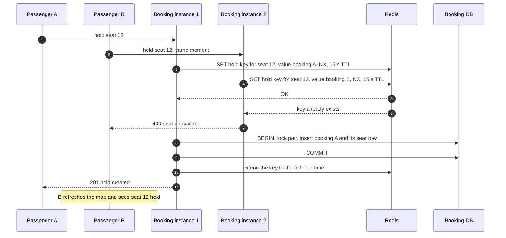
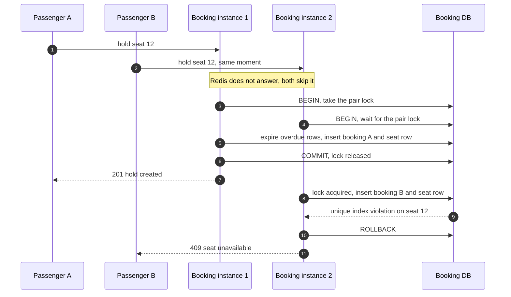
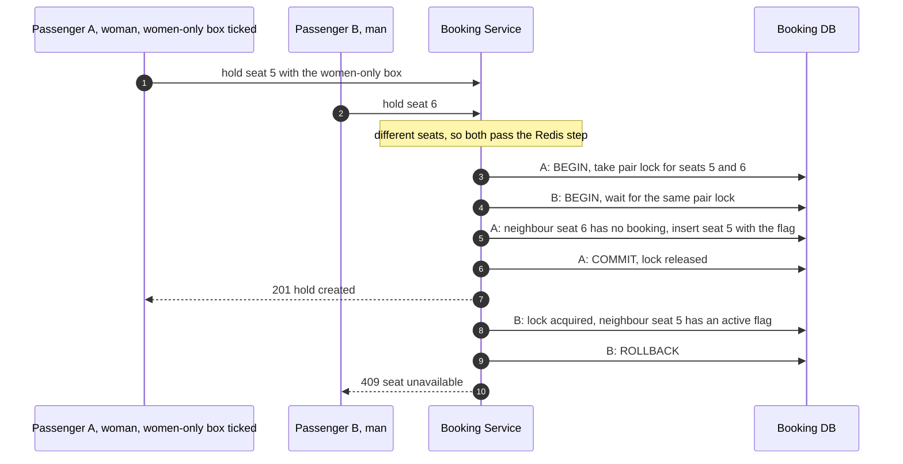

# Diagram 08: Concurrent booking sequence

Status: DRAFT for review. Not final until approved. Based on SRS v0.4 and diagrams 05 v2, 06, 07 and 11. It assumes the SQ-1 to SQ-6 recommendations of diagram 07 were accepted, with the one change in section 7.

Legend: [SRS] is a confirmed requirement. [REC] is a recommendation, not in the SRS. Open questions are in section 8.

## 1. What it shows

What happens when several passengers go for the same seat at the same moment, in four situations: Redis working, Redis down, several seats per request, and the women-only neighbour rule. This is the diagram behind SRS acceptance criterion 2: two passengers cannot both hold the same seat.

The guards are in Redis and PostgreSQL, never in application memory. So the rules below hold with any number of Booking Service instances.

## 2. Two passengers, one seat, Redis working

Redis runs commands one at a time, so of two `SET ... NX` on the same key exactly one succeeds, whichever instance sends it. The loser is rejected in about a millisecond and never touches the database. That is what keeps thousands of simultaneous requests for a popular seat cheap.

The key starts with a short 15 second TTL and is extended to the real hold time only after the database commit. This was a correction to diagram 07 (section 7). If the instance crashes between the two steps, the key disappears on its own within 15 seconds.

## 3. Redis is down

The pair lock makes the second request wait, and the unique index on active seats rejects it as soon as it reaches the insert [SRS BR-5, NFR-8]. This path is slower than Redis because every request waits on the database, but it gives the same answer. Booking Service treats Redis as unavailable after a short timeout (about 200 ms) and stops calling it for a few seconds, so a down Redis does not slow every request.

## 4. Several seats in one request

| Case | Redis path | Database path |
|---|---|---|
| A asks for seats 1 and 2, B asks for 2 and 3 | One script takes all of a request's keys or none. A gets 1 and 2. B finds 2 taken and gets nothing, so seat 3 is not left locked. | Seat rows are inserted in ascending seat id order, and pair locks are taken in ascending order. Two requests always queue in the same order, so they cannot deadlock. |
| B's request fails halfway | The script rolls back by itself. | The transaction rolls back, and the keys of this request are released by a compare-and-delete (only if the value is still this booking's id). |
| A's seat 2 is released while B waits | B retries from the map. There is no automatic retry. | Same. |

No request ever ends up holding part of what it asked for [SRS FR-P5 requires all seats of the booking].

## 5. The women-only neighbour rule

Seat 5 and seat 6 are neighbours. Passenger A (a woman) asks for seat 5 and ticks "keep my neighbour for women". Passenger B (a man) asks for seat 6 at the same moment [SRS BR-14].

The order could also go the other way. If B commits first, then A's request finds an active male neighbour on seat 6 and is rejected the same way, because a women-only request next to a man cannot be honoured (CQ-3). Either order ends with the same safe result: the flag and a male neighbour are never both active.

Rules checked inside the lock, for each requested seat:

1. If a neighbouring seat has an active booking with the women-only flag, and it is more than 2 hours before departure, this seat accepts only female or "prefer not to say" passengers [SRS BR-14, BR-15].
2. If this request has the women-only flag, no neighbouring seat may have an active booking from a male passenger (CQ-3).
3. Seats in the same booking never restrict each other, so a woman travelling with a male relative can sit together (CQ-4).

The lock is held until the transaction ends. A seat with no neighbour is its own pair. A seat with two neighbours (a row of three) takes the lock of each pair it belongs to, in ascending order.

Isolation is plain READ COMMITTED. The seat is protected by the unique index and the neighbour rule by the pair lock, so SERIALIZABLE (and its retries) is not needed.

## 6. Other races around the same seat

| Race | Outcome |
|---|---|
| A's hold timed out, the sweeper has not run, and B asks for the seat | B takes the Redis key (A's key is gone). In the database transaction, lazy expiry first marks A's overdue booking EXPIRED and frees its seat rows, then B inserts [SD-3]. |
| Same as above, but A's payment succeeds at that moment | B's transaction and A's confirmation use the version check. If B wins the seat, A's late success becomes T9 and the payment is reversed. If A's confirmation wins, B's insert fails on the unique index (diagram 06 section 7). |
| A releases the hold (T4) while B asks | Both go through the unique index. If B's insert comes first it fails, and B retries from the map. |
| One passenger sends the same hold request twice at once | `(user_id, client_request_id)` is unique, so only one booking is created and the other call returns it (diagram 07). |
| One passenger opens two tabs and holds seats in both | A second active hold on the same trip is rejected (SQ-4). This needs a partial unique index on `bookings (user_id, trip_id)` while the status is HELD or PENDING_PAYMENT. |

## 7. A correction to diagram 07

Diagram 07 said that when a request fails on an existing Redis key, it checks the database and replaces the key if no active booking owns the seat. That is wrong. In the few milliseconds between taking the key and committing the booking, the database has no row yet, so a live hold would look like an orphan, and a second request would steal its key.

The fix is the two-step TTL above: a 15 second provisional TTL, extended after the commit. A crash then leaves a ghost key for at most 15 seconds, and no database check is needed. The price is that a request can be wrongly refused for up to 15 seconds if the first request is about to fail in the database (for example on the neighbour rule). It is never wrongly accepted, because the database has the last word. Diagram 07 is updated for this in the same change.

## 8. Failure points

| Where | What goes wrong | What happens |
|---|---|---|
| Redis down | No fast gate | Database-only path (section 3). Correct, slower [SRS NFR-8]. |
| Redis returns after being down | Keys are missing for seats that have active bookings | No harm. The database index still rejects a second booking. The next successful hold restores the key. |
| A key expires early | Another request takes the key | The database unique index rejects the second booking if the first still exists. |
| The database transaction fails | Seat keys were taken | The request deletes its own keys by compare-and-delete. Otherwise the 15 second TTL ends them. |
| Pair lock waits too long | Requests queue | A lock timeout of 2 seconds. The request gets 503 and the passenger retries (CQ-1). |
| Two Booking instances run | In-memory checks would break | There are none. All guards are in Redis and PostgreSQL. |
| A deadlock between multi-seat requests | One request is killed by PostgreSQL | Prevented by ascending order for locks and inserts. If it still occurs, the request is retried once. |

## 9. How this will be tested

These tests are the proof of the design, and the load test in Phase 7 reuses them [SRS acceptance criterion 2]:

1. 200 parallel hold requests for one seat: exactly one gets 201, 199 get 409, and the database has exactly one active row for that seat.
2. The same test with Redis stopped.
3. Overlapping multi-seat requests: no request ends with fewer seats than it asked for, and the active seat rows equal the sum of the seats of successful holds.
4. 100 repeated neighbour races (a woman with the flag against a man): in no run are the flag and a male neighbour both active.
5. A hold timeout against a late payment: either the booking is confirmed or the payment is reversed, never both.

After each test, run a check query: no `(trip_id, trip_seat_id)` has more than one active row.

## 10. Decisions

Settled: SQ-2 from diagram 07 (advisory locks per neighbour pair) is adopted here as designed. Redis is only a fast gate, and the database holds the final decision.

## 11. Open for your decision

| ID | Question | Recommendation |
|---|---|---|
| CQ-1 | Lock per neighbour pair, or one lock per trip? | Per pair, with a 2 second lock timeout. A per-trip lock is simpler, but it makes every booking on a trip wait for every other. |
| CQ-2 | What does the passenger see when a hold is refused because of the women-only rules? | The same generic "seat unavailable" as any other conflict. A specific message would tell people the gender of a neighbour who has only a held seat, which [SRS DEC-3] hides until confirmation. |
| CQ-3 | Reject a women-only request when a neighbour already has a male booking, even a held one (rule 2)? Not in the SRS. | Yes. Otherwise the box gives a false sense of safety next to a man who is already there. |
| CQ-4 | Do seats in the same booking ignore the women-only rules for each other (rule 3)? Not in the SRS. | Yes, so families can sit together. |
| CQ-5 | Are the five tests in section 9 required acceptance tests, not optional? | Yes. They are the evidence for acceptance criterion 2. |

## 12. Effects on other documents

- Diagram 07: the Redis keys use a 15 second provisional TTL and are extended after the commit. The failure row and SQ-3 change to match.
- Diagram 05: one more index, a partial unique index on `bookings (user_id, trip_id)` where status is HELD or PENDING_PAYMENT, for SQ-4.
- SRS: rules 2 and 3 in section 5 (CQ-3, CQ-4) extend BR-14 if you approve them.
