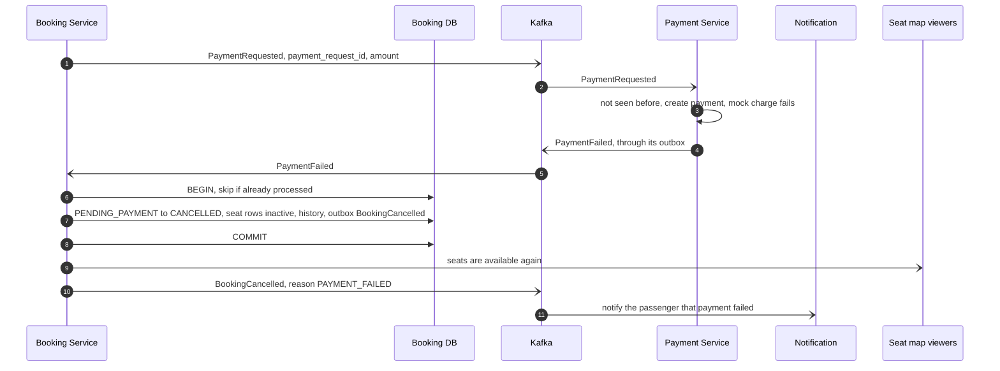
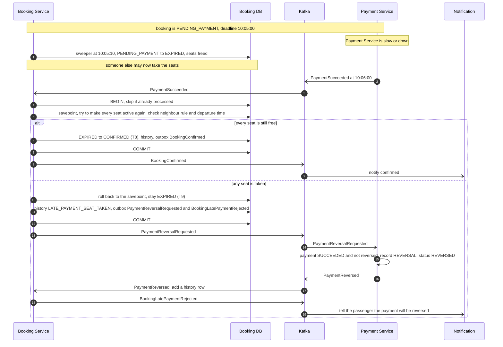

# Diagram 09: Payment saga sequence

Status: APPROVED on 2026-11-23. Based on SRS v0.5 and diagrams 05 v2, 06, 07, 08 and 11.

Legend: [SRS] is a confirmed requirement. [REC] is a recommendation, not in the SRS. Decisions are in section 9.

## 1. What it shows

How a booking and a payment stay consistent when things go wrong. The normal success path is in diagram 07, so this one covers the cases around it: payment failure, no answer before the deadline, a success that arrives late, and every kind of duplicate message.

## 2. The saga

A saga is a chain of local transactions, where each failure triggers a compensating action instead of a rollback across services. Booking Service is the orchestrator. It decides what happens next, and Payment Service is a participant that reacts to requests.

| Step | Where | State in the database | If it fails, the compensation is |
|---|---|---|---|
| 1. Hold the seats | Booking | HELD, seat rows `is_active` | Release the Redis keys, nothing else was written |
| 2. Create the pending booking | Booking | PENDING_PAYMENT, `payment_request_id` | None needed, nothing has left the service yet |
| 3. Request payment | Booking to Payment, over Kafka | PaymentRequested in the outbox | The hold expires on its own at the deadline |
| 4. Charge | Payment | payment and CHARGE transaction | A failed charge means no money moved |
| 5a. Success: confirm | Booking | CONFIRMED | Late case: reverse the payment (T9) |
| 5b. Failure: release and cancel | Booking | CANCELLED, seat rows inactive | None, this is the compensation |

The saga has no separate state table. Its state is the booking status, the `payment_request_id` and the history rows (diagram 05). Its timeout is the hold deadline, 5 minutes after the hold was created, which does not move [SRS BR-2].

## 3. Payment fails (T6)

No money moved, so the only compensation is to give the seats back. The passenger starts a new booking if they want to try again. There is no second payment on the same booking in v1 [D6].

## 4. No answer, then a late success (T7, T8, T9)

Notes on this path:

- The seats are re-activated in one transaction with a savepoint. If any seat violates the unique index or the neighbour rule, the seat changes roll back to the savepoint, and only the history row and the outbox rows are kept. So a booking is confirmed with all its seats or none, never part of them [SRS BR-10].
- A success that arrives after the deadline but before the sweeper ran is simply T5. The booking is still PENDING_PAYMENT, and its seats are still exclusively held (diagram 06, SD-5).
- A late success for a trip that has already departed cannot be confirmed. It goes to T9 (PS-2).
- Payment Service decides nothing about seats. It only reverses a payment when Booking asks, and only if that payment really succeeded and has not been reversed yet.
- After T9 the booking stays EXPIRED, with its history row (diagram 06, SD-6).

## 5. Duplicates and replays

Every message in the saga can arrive more than once, because delivery is at least once (diagram 11 section 10). Each hop has its own guard, and no guard relies on another one.

| Duplicate | Guard | Result |
|---|---|---|
| The passenger clicks Pay twice | Booking checks the status. The second request finds PENDING_PAYMENT, or the same `payment_request_id`. | Returns the current status. No second PaymentRequested. |
| PaymentRequested delivered twice | Payment's processed-events table by event id. | The second copy is skipped. The result of the first run is already on its way. |
| A new PaymentRequested with the same `payment_request_id` | UNIQUE idempotency key on payments [SRS BR-9]. | If the booking, amount and currency match, nothing happens. If they differ, it is treated as a bug: straight to the dead-letter topic and an alert, not a payment failure. |
| The mock charge runs twice | Partial unique index: one successful CHARGE per payment. | The second insert fails and rolls back. |
| PaymentSucceeded or PaymentFailed delivered twice | Booking's processed-events table, and the status guard. | The second copy is skipped. A status that already changed is ignored. |
| PaymentFailed arrives for a booking that is already EXPIRED or CANCELLED | Status guard. | Ignored and logged. The seats are already free. |
| PaymentSucceeded arrives for a CANCELLED booking | Status guard. | Ignored, with an alert, because Payment should never send both outcomes. |
| PaymentReversalRequested delivered twice | Processed-events, and one successful REVERSAL per payment. | The second is skipped. No double refund. |
| PaymentReversalRequested for a payment that did not succeed | Payment checks its own status. | Ignored with an alert. |

Because Payment writes its payment, its transaction row and its outbox row in one database transaction, a charge can never be recorded without its result event. With a real payment gateway there would be an extra gap (the money moved but the service crashed before recording it) that needs a reconciliation job. The mock has no such gap, so v1 does not build one.

## 6. Failure points

| If this fails | Effect | Behaviour |
|---|---|---|
| Payment Service is down | PaymentRequested waits in the topic | The booking expires at the deadline (T7). If Payment recovers and charges later, the late path (T8 or T9) takes over. |
| Kafka is down | The request waits in Booking's outbox | Same as above. |
| Booking is down when PaymentSucceeded arrives | The message waits in the topic | Processed when Booking returns, as T5, T8 or T9 depending on the time. |
| The outbox relay lags | Results arrive late | Handled like any delay: the deadline decides. |
| A consumer keeps failing on a message | Blocking retry, then the dead-letter topic | The saga for that booking stalls. The hold still expires. Seats are released at the deadline. An alert fires on the dead-letter topic. |
| Booking crashes in the middle of T8 | The transaction rolls back | The message is redelivered, and the processed-events insert rolled back with it, so it is processed again from the start. |
| The sweeper stops | Seats stay blocked after the deadline | Lazy expiry (diagram 06, SD-3) frees them as soon as someone asks. |

## 7. What the saga guarantees

- A seat is never sold twice. This holds regardless of anything here, because of the unique index (diagram 05).
- A confirmed booking has a successful payment, and a successful payment is either tied to a confirmed booking or reversed [SRS BR-8, BR-10].
- A failed payment always ends with the seats released [SRS acceptance criterion 5].
- There is no state where seats stay held forever: every non-final status has the deadline.
- What it does not guarantee is that it all happens at once. Between a payment succeeding and a booking being confirmed there can be a delay, and in that time the passenger sees PENDING_PAYMENT.

## 8. Decisions

Settled by this diagram, following earlier ones: orchestrated saga with Booking as the orchestrator (SRS prompt, diagram 03), the hold deadline as the saga timeout (SRS BR-2), the late-payment rules of diagram 06, and the outbox, processed-events and status guards of diagram 11.

## 9. Decisions taken on 2026-11-23, all accepted as recommended

| ID | Question | Decision |
|---|---|---|
| PS-1 | When a booking expires with a payment still pending, should Booking send a "cancel payment" message so the charge does not happen later? | No in v1. It needs one more event and does not remove the late case, because the cancel can arrive after the charge. The late path (T8, T9) already covers it. |
| PS-2 | Can a late success confirm a booking after the trip has already departed? Not covered by the SRS. | No. Treat it as T9: stay EXPIRED, reverse the payment. A seat on a bus that has left is of no use. |
| PS-3 | A PaymentRequested with a known idempotency key but different amount or booking. | Treat it as a permanent error: dead-letter topic and an alert. It signals a bug, so it should not quietly become a failed payment. |
| PS-4 | How many notifications for a reversed late payment? | One, at T9 ("your payment will be reversed"). Payment's PaymentReversed has no user id, so a second notification would need another event for little value. |
| PS-5 | The mock needs fixed behaviours for tests: success, failure, no answer, random. | Yes, through the `simulate` field, accepted only in the test profile [EV-5]. |

## 10. Effects on other documents

- Diagram 06: the T8 guard gets one more condition, "the trip has not departed" (PS-2).
- SRS BR-10: add "and the trip has not departed" if PS-2 is approved.
- Diagram 05 and diagram 11: no change needed.
