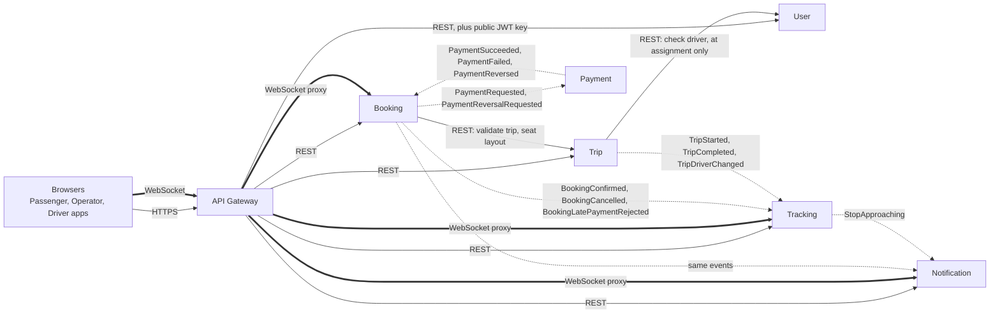
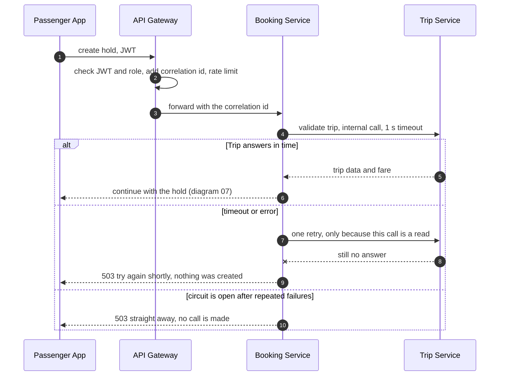

# Diagram 10: Service communication

Status: DRAFT for review. Not final until approved. Based on SRS v0.5 and diagrams 03, 04, 07, 09 and 11.

Legend: [SRS] is a confirmed requirement. [REC] is a recommendation, not in the SRS. Open questions are in section 9.

## 1. What it shows

Every way one part of the system talks to another, with the channel (REST, Kafka or WebSocket), the reason for it, and the rules that keep the system from turning into a tangle. Diagram 03 showed the pieces and diagram 11 showed the events. This one shows the whole graph on one page, and checks it against the rules in section 4.

## 2. Communication map

Solid arrows are REST calls, dotted arrows are Kafka messages, thick arrows are WebSocket connections. Databases and Redis are left out on purpose, since each service uses its own.

The gateway has no route to Payment Service. The only way to trigger a payment is through Booking.

## 3. Who talks to whom

| From \ To | User | Trip | Booking | Payment | Tracking | Notification |
|---|---|---|---|---|---|---|
| Gateway | REST, JWT key | REST | REST, WebSocket | none | REST, WebSocket | REST, WebSocket |
| User | | none | none | none | none | none |
| Trip | REST (driver check) | | none | none | Kafka | none |
| Booking | none | REST | | Kafka | Kafka | Kafka |
| Payment | none | none | Kafka | | none | none |
| Tracking | none | none | none | none | | Kafka |
| Notification | none | none | none | none | none | |

Reading it: Booking is the busiest service, with one REST call out (to Trip) and Kafka links to Payment, Tracking and Notification. User and Payment call nobody, except Payment answering Booking over Kafka.

### Reasons for each link

| Link | Channel | Why this channel |
|---|---|---|
| Browser to Gateway | HTTPS and WebSocket | Single entry point (diagram 03). |
| Gateway to User | REST | Login and registration. It also fetches the public key to verify JWTs, which is cached. |
| Booking to Trip | REST | Booking needs an immediate yes or no and the fare before it can create a hold [D5]. A message would add a wait for no benefit. |
| Trip to User | REST | The operator assigns a driver, and Trip must know the driver exists and belongs to that operator. It happens rarely and only on operator action (Q6). |
| Booking and Payment | Kafka | A payment can take time or fail, and the saga must survive a restart (diagram 09). |
| Booking to Tracking and Notification | Kafka | They react to a confirmed booking. Booking does not wait for them, and does not know what they do. |
| Trip to Tracking | Kafka | Tracking needs the driver and the stops when the trip starts. |
| Tracking to Notification | Kafka | Derived "bus approaching" alert, fire and forget. |
| Booking, Tracking and Notification to browsers | WebSocket | Live updates for the screen, bypassing Kafka (diagram 04). |

## 4. Rules this graph follows

1. No service reads another service's database [SRS prompt, diagram 03].
2. REST is for a question that needs an answer now. Kafka is for a change that other services react to later.
3. A Kafka consumer never calls another service inside its handler. It works from its own database. For example, Booking handles a late payment using the departure time it stored in the booking, not by asking Trip.
4. No request path goes deeper than one service-to-service call. The longest chain is gateway, Booking, Trip. Trip's call to User happens on a different request (driver assignment), so no chain of three exists.
5. The REST call graph has no cycles: Booking to Trip to User, and User calls no one.
6. Payment Service is not reachable from outside the system.
7. Internal endpoints use the path prefix `/internal/` and the gateway has no route for it.
8. Every REST call between services has a timeout. Every Kafka consumer has retries and a dead-letter topic (diagram 11).
9. A correlation id travels everywhere: the gateway creates it, REST calls pass it in a header, Kafka messages carry it in the envelope, and every log line includes it [SRS NFR-15].
10. No service needs another one to start. Booking starts without Trip and fails its calls at run time. This also means Docker Compose has no strict start order beyond the infrastructure.

All ten hold for the map in section 2.

## 5. Gateway routing and protection

Paths are provisional. The final names come with the API contracts.

| Path prefix | Goes to | Who can call |
|---|---|---|
| `/api/v1/auth/**` | User | Anyone (login, register, refresh) |
| `/api/v1/users/**` | User | Logged-in users, operators for driver accounts |
| `/api/v1/trips/**`, `buses`, `routes`, `stops` | Trip | Search is open to logged-in passengers. Management is operator only. |
| `/api/v1/bookings/**`, `/ws/seats` | Booking | Passengers. Manifest and counts are operator only. |
| `/api/v1/tracking/public/**` | Tracking | Anyone with a valid tracking token, no JWT |
| `/api/v1/tracking/**`, `/ws/tracking` | Tracking | Drivers send points. Passengers create links. |
| `/api/v1/notifications/**`, `/ws/notifications` | Notification | The logged-in user, their own notifications only |
| `/internal/**` | nothing | Blocked at the gateway |

The gateway checks that the JWT is valid and that the role is allowed for the path. The service then checks the details, such as "this booking belongs to this passenger". Both checks exist so that a mistake in one does not open the system [diagram 04].

The gateway also handles CORS for the three frontends, adds the correlation id, and applies rate limits from counters in Redis (SQ-4, SC-4).

## 6. Calls that can fail, and what happens

| Call | Timeout | Retry | If the callee is down |
|---|---|---|---|
| Gateway to any service | 5 s | none | 503 to the client |
| Booking to Trip, seat layout (map) | 1 s | 1 | The map is served from a cached layout if there is one, otherwise 503 |
| Booking to Trip, validate trip (new hold) | 1 s | 1 | 503, no hold is created [D5] |
| Trip to User, check driver | 1 s | none | The assignment is refused, the operator tries again |
| Gateway to User, public key | 1 s | 1 | The cached key keeps working until it expires, so logins are not affected |

The read calls are retried once because repeating them changes nothing. Calls that change state are not retried automatically. They rely on a request id from the client instead (`client_request_id`, diagram 07).

After five failures in ten seconds, Booking stops calling Trip for ten seconds, so a Trip outage makes holds fail fast instead of piling up waiting threads (SC-2).

## 7. Security between services

- Internal REST endpoints (`/internal/**`) are not routed by the gateway and are reachable only on the private Docker network. The calling service passes the user's JWT along, so the callee can log who the call is for, and checks the role where it matters.
- There are no separate service accounts or mutual TLS in v1. A service inside the network is trusted. This is acceptable for a local learning project and would not be enough in production (SC-1).
- Kafka and Redis have no authentication locally. Production would add credentials and network rules.
- Secrets (database passwords, Redis password) come from environment variables, never from the repository.

## 8. Failure points

| If this fails | Effect | Behaviour |
|---|---|---|
| Gateway | Everything outside is cut off | Single instance in v1, accepted. |
| Trip Service | No new holds, no search, no operator trip changes | Existing bookings, payments and tracking continue. |
| User Service | No new logins, no new driver accounts | Logged-in users keep working until their JWT expires (15 minutes), and the gateway keeps its cached key. |
| Booking Service | No holds, no bookings | Payment results wait in Kafka. |
| Payment Service | Payments are not processed | Holds expire. A late success follows diagram 09. |
| Kafka | Saga and event flows stop | Holds still work. Events wait in outboxes (diagram 11). |
| Redis | No fast holds, no rate limits, no WebSocket tickets | Booking falls back to the database. Rate limits fail open. WebSocket connections cannot start until Redis returns, but REST still works. |
| Tracking or Notification | Their own features stop | Nothing else is affected, since nobody calls them synchronously. |

## 9. Open for your decision

| ID | Question | Recommendation |
|---|---|---|
| SC-1 | How are internal calls secured? | Private network, no gateway route for `/internal`, and the user's JWT passed along. Service tokens or mutual TLS are a later step. |
| SC-2 | Add a circuit breaker library (Resilience4j) for Booking to Trip? | Yes, for that one call. It is a standard answer to "what happens when a dependency is down" and costs one dependency. |
| SC-3 | A service registry (Eureka) or config server? | No. Both are extra containers on a 7 GB laptop. Gateway routes and service URLs come from environment variables, and Docker's own DNS resolves service names. |
| SC-4 | Rate limits at the gateway, from Redis counters. | Login 5 per minute per IP, hold creation 10 per minute per user, everything else 120 per minute per user. These are starting values. |
| SC-5 | Who issues the one-time WebSocket tickets? | Each service that owns a WebSocket issues its own, valid for 30 seconds and usable once, stored in Redis. |
| SC-6 | Timeouts and retries as in section 6. | Yes: 1 second for internal calls, one retry for reads only. |
| SC-7 | API versioning. | A version in the path, `/api/v1/...`. A breaking change would add `/api/v2/`. |

## 10. Effects on other documents

- Diagram 03 already has the Trip to User arrow (added in the consistency edit).
- The API contracts will turn section 5 into the real endpoint list per service.
- The Phase 3 Docker Compose file takes its health checks and start order from rule 10.
