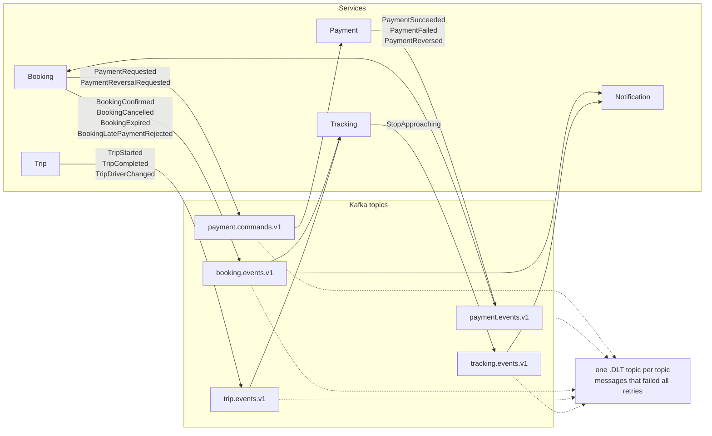
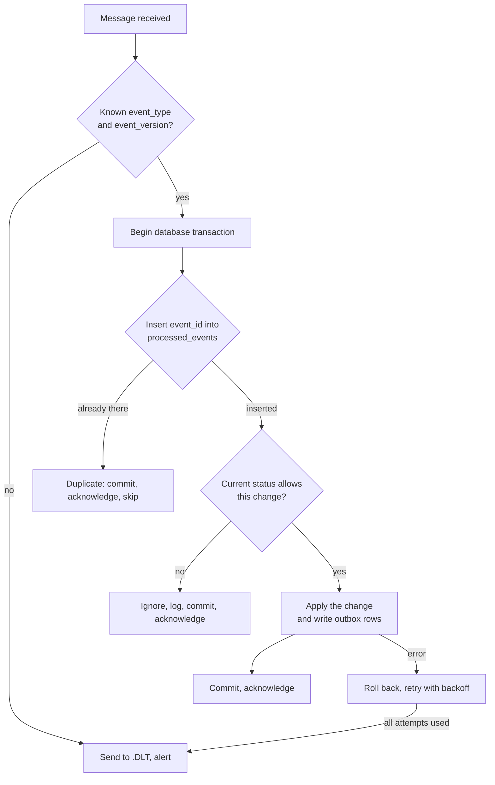

# Diagram 11: Kafka event-driven architecture

Status: APPROVED on 2026-11-23. Based on SRS v0.5 and diagrams 03, 04, 05 v2 and 06.

Legend: [SRS] is a confirmed requirement. [REC] is a recommendation, not in the SRS. Decisions are in section 12.

## 1. What it shows

Which events exist, which service publishes each one, which services consume it, which topic carries it, and what the rules are for versions, ordering, duplicates, retries and failures. It also lists the events the earlier diagrams turned out to need that were not in the original list.

Kafka carries business events and the payment saga messages. It does not carry live updates for the screen: the seat map, the bus position and notifications reach browsers over WebSocket straight from the owning service (diagram 04).

## 2. Event architecture

Solid arrows into a topic are publishers, and arrows out of a topic go to consumers. Dotted arrows are dead-letter topics.



Producers Booking, Payment and Trip write each event to their own outbox table in the same transaction as the business change, and a relay publishes it (section 6). Tracking publishes directly, because a lost "bus approaching" event only skips an in-app alert (diagram 05).

## 3. Topics

| Topic | Key | Events | Producer | Consumers |
|---|---|---|---|---|
| `payment.commands.v1` | booking_id | PaymentRequested, PaymentReversalRequested | Booking | Payment |
| `payment.events.v1` | booking_id | PaymentSucceeded, PaymentFailed, PaymentReversed | Payment | Booking |
| `booking.events.v1` | booking_id | BookingConfirmed, BookingCancelled, BookingExpired, BookingLatePaymentRejected | Booking | Tracking, Notification |
| `trip.events.v1` | trip_id | TripStarted, TripCompleted, TripDriverChanged | Trip | Tracking |
| `tracking.events.v1` | trip_id | StopApproaching | Tracking | Notification |

Local settings [REC]: 3 partitions per topic, replication factor 1 (one broker), 7 days retention, no compaction. A production setup would use replication factor 3. The topic name ends in `.v1`, so a breaking change to a contract goes to a `.v2` topic (section 5).

The key is always the id of the aggregate the event is about. Events with the same key go to the same partition and stay in order (section 9).

## 4. Event catalog

All payloads carry ids and business facts only. No passenger name, phone or gender ever appears in an event [SRS NFR-6]. Every event also has the envelope from section 5.

### 4.1 Published in version 1

| Event | Produced when | Payload (besides the envelope) |
|---|---|---|
| PaymentRequested | Booking: T2, passenger pays | payment_request_id (idempotency key), booking_id, amount, currency |
| PaymentReversalRequested | Booking: T9, late success but a seat is gone | payment_request_id, booking_id, reason |
| PaymentSucceeded | Payment: charge succeeded | payment_id, payment_request_id, booking_id, amount, currency, provider_reference, completed_at |
| PaymentFailed | Payment: charge failed | payment_id, payment_request_id, booking_id, reason, completed_at |
| PaymentReversed | Payment: reversal recorded | payment_id, booking_id, amount, currency, reversed_at |
| BookingConfirmed | Booking: T5 or T8 | booking_id, booking_reference, user_id, trip_id, confirmed_at, route_name, origin, destination, departure_time, boarding_stops (list of stop id and name) |
| BookingCancelled | Booking: T6 or T4 | booking_id, booking_reference, user_id, trip_id, reason (PAYMENT_FAILED or PASSENGER_RELEASED), cancelled_at |
| BookingLatePaymentRejected | Booking: T9 | booking_id, booking_reference, user_id, trip_id, reason, occurred_at |
| TripStarted | Trip: driver starts the trip | trip_id, driver_id, operator_user_id, departure_time, started_at, source_version, stops (list of trip_stop_id, stop_sequence, stop_name, latitude, longitude, distance_from_start_km, scheduled_time) |
| TripCompleted | Trip: trip ends | trip_id, completed_at, source_version |
| TripDriverChanged | Trip: operator changes the driver | trip_id, old_driver_id, new_driver_id, changed_at, source_version |
| StopApproaching | Tracking: the bus is near a stop | trip_id, trip_stop_id, stop_name, eta_minutes, occurred_at |

### 4.2 Defined but not published in version 1

These are in your original event list. They have contracts so their shape is agreed, but nobody consumes them yet (EV-1).

| Event | Why it is held back |
|---|---|
| SeatHeld, SeatReleased | The seat map is fed from inside Booking over WebSocket. Payload when needed: trip_id, trip_seat_id, booking_id, seat_version, occurred_at. |
| BookingExpired | No notification is wanted for a timed-out hold [SRS FR-P11]. Payload: booking_id, booking_reference, user_id, trip_id, expired_at. |
| LocationUpdated | The live map bypasses Kafka (diagram 04). Payload when needed: trip_id, session_id, sequence_no, latitude, longitude, recorded_at. |

### 4.3 What was added to the original list

| Event | Why it is needed |
|---|---|
| PaymentReversalRequested, PaymentReversed | The late-payment path (T9, SRS BR-10). Payment cannot decide on its own that a seat is gone, so Booking asks for the reversal. |
| TripDriverChanged | Tracking keeps the assigned driver and must reject points from the wrong driver [SRS BR-20]. |
| BookingLatePaymentRejected | Found while mapping Notification's inputs. Payment holds no user id, so only a Booking event can tell Notification which passenger to inform about a reversal. Diagram 06 needs this added to T9 (EV-3). |
| StopApproaching | Derived event from Tracking to Notification for the "bus is near your stop" alert [SRS FR-P11]. |

### 4.4 Who consumes what, and what they do

| Consumer | Event | Action |
|---|---|---|
| Booking | PaymentSucceeded | Run the decision in diagram 06 section 6: T5, T8 or T9. |
| Booking | PaymentFailed | T6: cancel and release the seats. |
| Booking | PaymentReversed | Add a history row. |
| Payment | PaymentRequested | Create the payment and run the mock charge. Repeats return the stored result. |
| Payment | PaymentReversalRequested | Record a REVERSAL transaction, then publish PaymentReversed. |
| Tracking | BookingConfirmed | Insert confirmed_booking_refs (ids only). |
| Tracking | TripStarted | Insert trip_refs and trip_stop_refs. |
| Tracking | TripDriverChanged | Update trip_refs.driver_id if it exists and the version is newer. |
| Tracking | TripCompleted | Set completed_at, and set `expires_at` on tokens to completed_at plus 2 hours [SRS BR-28]. |
| Notification | BookingConfirmed | Store a notification and insert boarding_subscriptions. |
| Notification | BookingCancelled | Notify only when the reason is PAYMENT_FAILED. A passenger who released a hold needs no message. |
| Notification | BookingLatePaymentRejected | Notify that the payment will be reversed. |
| Notification | StopApproaching | Notify the booked passengers at that stop, once (`notified_at`). |

## 5. Envelope and versioning

Every message is JSON with this envelope [REC]:

```json
{
  "event_id": "uuid, same as the outbox row",
  "event_type": "BookingConfirmed",
  "event_version": 1,
  "occurred_at": "2026-11-17T10:15:30Z",
  "producer": "booking-service",
  "aggregate_type": "Booking",
  "aggregate_id": "uuid, also the Kafka key",
  "correlation_id": "uuid from the gateway request",
  "payload": { }
}
```

Kafka headers carry `event_type` and `event_version` as well, so a consumer can skip events it does not handle without parsing the body.

Versioning rules:

- Within one version, only additive changes: new optional fields. Consumers ignore fields they do not know.
- Removing or renaming a field, or changing its meaning, is a new `event_version` and a new topic suffix (`.v2`). The producer publishes both for a while, and consumers move over one at a time.
- A consumer that receives an `event_version` it does not support sends the message to the dead-letter topic and raises an alert. It does not guess.
- The contracts are kept as JSON Schema files under `docs/api/events/` and checked in tests (EV-2).

## 6. Producer side: the transactional outbox

1. The service changes its business rows and inserts an `outbox_events` row in the same database transaction.
2. A relay inside the service reads rows with `published_at` null, oldest first, in small batches (every 500 ms, 100 rows).
3. It publishes each one with the aggregate id as key, with `acks=all` and an idempotent producer.
4. After Kafka acknowledges, it sets `published_at`.

If the service crashes between steps 3 and 4, the relay publishes the row again after the restart. So a duplicate is possible by design, and every consumer must handle it (section 7). If Kafka is down, rows pile up and are sent when it returns [SRS NFR-9].

A change-data-capture tool such as Debezium would do the same job without a polling relay, but it needs extra containers that a 7 GB laptop cannot spare.

## 7. Consumer side: idempotent processing



The consumer's `processed_events` insert and its business change are in one transaction, so the "seen" mark never exists without the change, and the change never happens twice. Besides this check, every change is guarded by the current status (for example, a booking only moves from PENDING_PAYMENT to CONFIRMED if it is in PENDING_PAYMENT), so a replay is harmless even if the id check were missed.

## 8. Retries and dead-letter topics

| Failure kind | Example | What happens |
|---|---|---|
| Temporary | Database down for a moment, timeout | The consumer retries in place with exponential backoff: 1 s, 2 s, 4 s, 8 s, 16 s, then gives up (about 30 seconds). |
| Permanent | Unknown event version, invalid JSON, missing required field | No retry. Straight to the dead-letter topic. |
| Out of retries | Still failing after the last attempt | Published to `<topic>.DLT` with the same key and the error in headers. The consumer then moves on. |

Dead-letter topics are kept for 14 days. A DLT message triggers an alert, and a script in `scripts/` republishes it after the cause is fixed [REC].

I recommend blocking retries (the consumer waits on the same partition) over separate retry topics. Retry topics let later messages overtake the failing one, which breaks the ordering in section 9. The price of blocking is that one bad message delays its partition for up to 30 seconds (EV-4).

## 9. Ordering

- Kafka keeps order only inside one partition. Using the aggregate id as key puts all events of one booking, or one trip, in one partition, in the order they were written.
- There is no order between different topics or different keys. Consumers must not rely on one. For example, Tracking can receive BookingConfirmed before or after TripStarted. The two write to different tables (`confirmed_booking_refs` and `trip_refs`), so either order works.
- Trip events carry `source_version`. Tracking ignores an event whose version is not newer than the stored one, and ignores TripDriverChanged if the trip has not started yet, since TripStarted will carry the current driver.
- Where an outbox relay publishes in id order, order is kept for rows with the same key.

## 10. What Kafka does and does not guarantee

- With this setup, delivery is at least once. A message may be delivered more than once, after a relay restart or a consumer restart before its offset was saved.
- Kafka does not make the business processing happen exactly once by itself. That result comes from our design: the outbox (no lost events), the processed-events check and status guards (no repeated effect), and the idempotency key on payments [SRS BR-9, NFR-10].
- Kafka transactions are not used. They only cover Kafka-to-Kafka work, not a write to PostgreSQL.

## 11. Failure points

| If this fails | Effect | Behaviour |
|---|---|---|
| Kafka is down | No saga messages move. | Producers keep working and fill their outboxes. Holds expire as usual. A payment result that arrives after Kafka returns goes through T8 or T9. |
| A consumer is down | Its topics fill up. | It continues from its saved offset when it returns. Nothing is lost within the retention period (7 days). |
| The relay stops | Events stay in the outbox. | `outbox_events` rows with `published_at` null and age over a threshold are a metric and an alert. |
| A poison message | One partition is delayed. | Blocking retry for about 30 seconds, then the dead-letter topic. |
| Duplicate delivery | A change could be applied twice. | processed_events and the status guards stop it. |
| Wrong event version | The consumer cannot read the message. | Dead-letter topic and an alert. |
| Notification or Tracking is slow | Only its own topic lags. | Other consumers are not affected, since each has its own consumer group. |
| The Kafka broker loses data (single broker, local only) | Messages not yet consumed are lost. | Accepted for local use. The outbox still holds anything not marked as published. Production needs replication. |

## 12. Decisions

Settled by this diagram, following earlier decisions:

- Outbox in Booking, Payment and Trip. Tracking publishes directly [diagram 05].
- Live updates bypass Kafka [diagram 04].
- At-least-once delivery, with the idempotent consumer pattern. No claim of exactly-once processing.
- Aggregate id as key, one topic per domain with a version suffix.

Decided on 2026-11-23, all accepted as recommended:

| ID | Question | Decision |
|---|---|---|
| EV-1 | Do SeatHeld, SeatReleased, BookingExpired and LocationUpdated get published in v1, though nothing consumes them? | No. Keep the contracts, do not publish. It saves writes and avoids unused topics. Switch them on when a consumer exists. |
| EV-2 | Message format and schema management. | JSON with JSON Schema files in the repo, checked in tests. No schema registry, which would be an extra container. |
| EV-3 | Add BookingLatePaymentRejected, and add it to T9 in diagram 06? | Yes. It is the only way Notification learns which user to inform. It is a small edit to diagram 06's event column for T9. |
| EV-4 | Blocking retry or retry topics. | Blocking, to keep ordering. |
| EV-5 | The mock payment needs a way to force success, failure or a timeout in tests. Put a `simulate` field in PaymentRequested? | Yes, but only accepted when the service runs with the test profile, and ignored otherwise. |
| EV-6 | Should the BookingConfirmed event carry route name, cities and departure time, so Notification can write a readable message? | Yes. It is trip data, not personal data, and it saves Notification a call to Trip Service. |

## 13. Effects on other documents

- Diagram 06: add BookingLatePaymentRejected to the events published by T9 (EV-3).
- Diagram 05: no change. Every field the events need already exists.
- Diagram 03: the follow-up edit already planned (the Trip Service row of the failure table, and a Trip to User arrow) still stands. This diagram needs no change to it.
- The event contracts will be turned into JSON Schema files in `docs/api/events/` in the API contracts step (Phase 2, task 5).
